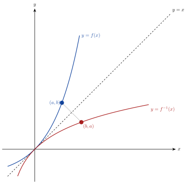

<!-- video: kommer (videoer/kalkulus/01-01-inverse-funksjoner) -->
{fig-alt="Video kommer"}

<!-- tillegg: Claude -->
En funksjon tar inn $x$ og gir ut $y$. Ofte vil vi gå andre veien: Vi vet temperaturen i fahrenheit og vil ha celsius, eller vi vet hvor mye som er igjen av et radioaktivt stoff og vil vite hvor lang tid som har gått. Funksjonen som går baklengs, heter den **inverse funksjonen**.

## Én-entydige funksjoner

Ikke alle funksjoner kan reverseres. Funksjonen $f(x) = x^2$ gir $f(2) = f(-2) = 4$. Får vi vite at svaret ble $4$, kan vi ikke vite om vi startet i $2$ eller $-2$. For å kunne gå baklengs må hver $y$-verdi komme fra **én** $x$-verdi.

::: {.callout-note title="Definisjon: Én-entydig funksjon"}
En funksjon $f$ er **én-entydig** (injektiv) hvis
$$
x_1 \neq x_2 \quad\Longrightarrow\quad f(x_1) \neq f(x_2)
$$
for alle $x_1, x_2$ i definisjonsmengden $D_f$.
:::

Grafisk betyr det at **enhver vannrett linje skjærer grafen høyst én gang** (den vannrette linjetesten). En funksjon som er strengt voksende eller strengt avtakende på hele definisjonsmengden, er alltid én-entydig. Det er slik vi oftest viser det: Er $f'(x) > 0$ på et intervall, er $f$ strengt voksende der.

::: {.callout-note title="Definisjon: Invers funksjon"}
La $f$ være én-entydig med definisjonsmengde $D_f$ og verdimengde $V_f$. Den **inverse funksjonen** $f^{-1}$ har definisjonsmengde $V_f$ og verdimengde $D_f$, og
$$
f^{-1}(y) = x \quad\Longleftrightarrow\quad f(x) = y .
$$
Da er $f^{-1}\big(f(x)\big) = x$ for alle $x$ i $D_f$ og $f\big(f^{-1}(y)\big) = y$ for alle $y$ i $V_f$.
:::

Merk at $f^{-1}(x)$ **ikke** betyr $\dfrac{1}{f(x)}$. Den inverse funksjonen «angrer» det $f$ gjorde.

## Grafen speiles i linja y = x

Ligger punktet $(a, b)$ på grafen til $f$, er $f(a) = b$, og da er $f^{-1}(b) = a$. Punktet $(b, a)$ ligger altså på grafen til $f^{-1}$. Å bytte om koordinatene er det samme som å speile punktet i linja $y = x$.

{.tikz-fig fig-alt="Grafen til f og grafen til den inverse funksjonen, speilet om linja y = x. Punktet (a, b) på den ene grafen svarer til punktet (b, a) på den andre."}

I figuren er $f(x) = \mathrm{e}^x - 1$ og $f^{-1}(x) = \ln(x + 1)$. Der $f$ er bratt, er $f^{-1}$ slak, og omvendt. Den sammenhengen skal vi gjøre presis når vi [deriverer inverse funksjoner](../03-derivasjon/07-inverse-funksjoner.qmd).

## Slik finner vi den inverse

::: {.steg}
1. **Sjekk at funksjonen er én-entydig**, f.eks. med fortegnet til den deriverte. Begrens definisjonsmengden om nødvendig.
2. **Skriv** $y = f(x)$ og **løs** likningen med hensyn på $x$.
3. **Bytt navn**: Svaret $x = g(y)$ gir $f^{-1}(x) = g(x)$.
4. **Bytt mengdene**: $D_{f^{-1}} = V_f$ og $V_{f^{-1}} = D_f$.
:::

::: {.eksempel}
**Eksempel: Fra celsius til fahrenheit og tilbake.** Temperaturen i fahrenheit er $F = f(C) = 1.8\,C + 32$. Finn den inverse funksjonen, og bruk den til å gjøre om $98.6\ ^\circ\mathrm{F}$ til celsius.

::: {.losning}
Funksjonen er lineær med stigningstall $1.8 > 0$, så den er strengt voksende og dermed én-entydig. Vi løser $F = 1.8\,C + 32$ med hensyn på $C$:
$$
C = \frac{F - 32}{1.8}, \qquad\text{så}\qquad f^{-1}(F) = \frac{F - 32}{1.8} .
$$
Med $F = 98.6$:
$$
f^{-1}(98.6) = \frac{98.6 - 32}{1.8} = \frac{66.6}{1.8} = \underline{\underline{37.0\ ^\circ\mathrm{C}}}
$$
:::
:::

::: {.eksempel}
**Eksempel: En rasjonal funksjon.** Vis at $f(x) = \dfrac{2x + 1}{x - 3}$, $x \neq 3$, er én-entydig, og finn $f^{-1}$ med definisjonsmengde.

::: {.losning}
Kvotientregelen gir
$$
f'(x) = \frac{2(x - 3) - (2x + 1)}{(x - 3)^2} = \frac{-7}{(x - 3)^2} < 0 .
$$
Funksjonen er strengt avtakende på hvert av intervallene $(-\infty, 3)$ og $(3, \infty)$. Det er ikke nok alene, men på venstre side er $f(x) < 2$ og på høyre side er $f(x) > 2$ (skriv $f(x) = 2 + \dfrac{7}{x - 3}$), så ingen $y$-verdi treffes to ganger. Funksjonen er én-entydig, og verdimengden er $V_f = \mathbb{R}\setminus\{2\}$.

Vi løser $y = \dfrac{2x + 1}{x - 3}$:
$$
y(x - 3) = 2x + 1 \;\Longrightarrow\; yx - 2x = 3y + 1 \;\Longrightarrow\; x = \frac{3y + 1}{y - 2} .
$$
Dermed er
$$
f^{-1}(x) = \frac{3x + 1}{x - 2}, \qquad D_{f^{-1}} = \mathbb{R}\setminus\{2\} .
$$
Kontroll: $f(0) = -\tfrac13$, og $f^{-1}\!\left(-\tfrac13\right) = \dfrac{-1 + 1}{-\tfrac13 - 2} = 0$. Det stemmer.
:::
:::

## Når funksjonen ikke er én-entydig

Funksjonen $f(x) = x^2$ er ikke én-entydig på $\mathbb{R}$. Men begrenser vi definisjonsmengden til $[0, \infty)$, er den strengt voksende, og den inverse er $f^{-1}(x) = \sqrt{x}$. Kvadratroten er altså definert som den inverse til $x^2$ **på den positive halvdelen**. Det er grunnen til at $\sqrt{x^2} = |x|$, ikke $x$.

Den samme idéen gir [arcusfunksjonene](02-arcusfunksjoner.qmd): Sinus er ikke én-entydig, men den er det på et passende valgt intervall.

::: {.callout-tip title="Til ettertanke"}
Logaritmen $\ln x$ er definert som den inverse funksjonen til $\mathrm{e}^x$. Hvilke av regnereglene for $\ln$ følger direkte av at $\ln(\mathrm{e}^x) = x$ og $\mathrm{e}^{\ln x} = x$? Prøv å utlede $\ln(ab) = \ln a + \ln b$ fra $\mathrm{e}^{u + v} = \mathrm{e}^u\mathrm{e}^v$.
:::

## Prøv selv

Programmet tegner en funksjon og den inverse, og sjekker at $f^{-1}(f(x)) = x$. Bytt ut funksjonen med en annen én-entydig funksjon og dens inverse.

```{.python .kjor}
import numpy as np
import matplotlib.pyplot as plt

f = lambda x: np.exp(x) - 1          # funksjonen
g = lambda x: np.log(x + 1)          # den inverse

x = np.linspace(-1, 1.6, 200)
y = np.linspace(-0.6, 3.9, 200)
plt.plot(x, f(x), label="f(x)")
plt.plot(y, g(y), label="f⁻¹(x)")
plt.plot([-1, 4], [-1, 4], "k--", lw=1, label="y = x")
plt.gca().set_aspect("equal"); plt.grid(alpha=0.3); plt.legend()
plt.show()

print("største avvik |f⁻¹(f(x)) - x| =", np.max(np.abs(g(f(x)) - x)))
```

:::: {.oppgaver}

::: {.oppgave tittel="Finn den inverse"}
Finn den inverse funksjonen til $f(x) = 5 - 2x^3$. Hva er $D_{f^{-1}}$?

::: {.losning}
$f'(x) = -6x^2 \leq 0$, med likhet bare i $x = 0$, så $f$ er strengt avtakende og én-entydig. Vi løser $y = 5 - 2x^3$:
$$
x^3 = \frac{5 - y}{2} \;\Longrightarrow\; x = \sqrt[3]{\frac{5 - y}{2}} .
$$
Dermed er $f^{-1}(x) = \sqrt[3]{\dfrac{5 - x}{2}}$, og $D_{f^{-1}} = V_f = \mathbb{R}$.
:::
:::

::: {.oppgave tittel="Begrens definisjonsmengden"}
Funksjonen $f(x) = (x - 1)^2 + 3$ er ikke én-entydig på $\mathbb{R}$.

a) Finn det største intervallet som inneholder $x = 2$, der $f$ er én-entydig.

b) Finn den inverse funksjonen på dette intervallet, med definisjons- og verdimengde.

::: {.losning}
a) $f'(x) = 2(x - 1)$ er positiv for $x > 1$. Intervallet er $[1, \infty)$.

b) Vi løser $y = (x - 1)^2 + 3$ med $x \geq 1$: $x - 1 = \sqrt{y - 3}$ (den positive roten, fordi $x - 1 \geq 0$). Altså
$$
f^{-1}(x) = 1 + \sqrt{x - 3}, \qquad D_{f^{-1}} = [3, \infty), \qquad V_{f^{-1}} = [1, \infty) .
$$
:::
:::

::: {.oppgave tittel="Radioaktivt henfall" niva="Middels"}
Mengden av et radioaktivt stoff er $N(t) = N_0\,\mathrm{e}^{-\lambda t}$. For karbon-14 er $\lambda = 1.21\cdot 10^{-4}\ \mathrm{år}^{-1}$.

a) Finn den inverse funksjonen $t(N)$, altså tiden som funksjon av mengden.

b) I en trebit er det igjen $35\ \%$ av den opprinnelige mengden karbon-14. Hvor gammel er trebiten?

::: {.losning}
a) Fra $N = N_0\,\mathrm{e}^{-\lambda t}$ får vi $\dfrac{N}{N_0} = \mathrm{e}^{-\lambda t}$, og med $\ln$ på begge sider:
$$
t(N) = -\frac{1}{\lambda}\ln\frac{N}{N_0} = \frac{1}{\lambda}\ln\frac{N_0}{N} .
$$

b) Med $\dfrac{N}{N_0} = 0.35$:
$$
t = \frac{\ln(1/0.35)}{1.21\cdot 10^{-4}\ \mathrm{år}^{-1}} = \frac{1.050}{1.21\cdot 10^{-4}}\ \mathrm{år} = \underline{\underline{8.7\cdot 10^{3}\ \mathrm{år}}}
$$
:::
:::

::: {.oppgave tittel="Sin egen inverse" niva="Utfordrende"}
Vis at $f(x) = \dfrac{ax + b}{cx - a}$ er sin egen inverse, altså at $f\big(f(x)\big) = x$ (anta $a^2 + bc \neq 0$). Hva betyr det for grafen?

::: {.losning}
Sett $u = f(x) = \dfrac{ax + b}{cx - a}$. Da er
$$
f(u) = \frac{a\dfrac{ax + b}{cx - a} + b}{c\dfrac{ax + b}{cx - a} - a} = \frac{a(ax + b) + b(cx - a)}{c(ax + b) - a(cx - a)} = \frac{(a^2 + bc)\,x}{a^2 + bc} = x .
$$
Siden $f\big(f(x)\big) = x$, er $f^{-1} = f$. Grafen er sitt eget speilbilde om linja $y = x$, altså symmetrisk om denne linja. Funksjonen i eksemplet over er ikke av denne typen (der står $-3$, ikke $-2$, i nevneren), og der er grafen til $f$ og $f^{-1}$ forskjellige.
:::
:::

::::
