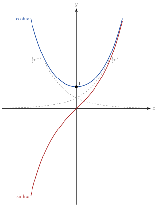

<!-- video: kommer (videoer/kalkulus/01-03-hyperbolske-funksjoner) -->
{fig-alt="Video kommer"}

<!-- tillegg: Claude -->
En kraftledning eller en kjetting som henger fritt mellom to punkter, ser ut som en parabel, men er det ikke. Kurven heter en **kjedelinje**, og den er grafen til $\cosh x$, den hyperbolske cosinus. De hyperbolske funksjonene er laget av $\mathrm{e}^x$ og $\mathrm{e}^{-x}$, og de oppfører seg påfallende likt de trigonometriske.

## Definisjon

::: {.callout-note title="Definisjon: Hyperbolsk sinus, cosinus og tangens"}
$$
\sinh x = \frac{\mathrm{e}^x - \mathrm{e}^{-x}}{2}, \qquad \cosh x = \frac{\mathrm{e}^x + \mathrm{e}^{-x}}{2}, \qquad \tanh x = \frac{\sinh x}{\cosh x} = \frac{\mathrm{e}^x - \mathrm{e}^{-x}}{\mathrm{e}^x + \mathrm{e}^{-x}} .
$$
:::

$\cosh x$ er gjennomsnittet av $\mathrm{e}^x$ og $\mathrm{e}^{-x}$. For store $x$ er $\mathrm{e}^{-x}$ nesten null, så både $\cosh x$ og $\sinh x$ blir nesten lik $\tfrac12\mathrm{e}^x$.

{.tikz-fig fig-alt="Grafen til cosh x er en symmetrisk U-form med bunnpunkt i (0, 1). Grafen til sinh x går gjennom origo og er voksende. For store x nærmer begge seg grafen til en halv e opphøyd i x."}

Fra figuren og definisjonen ser vi:

::: {.kort}
- **$\cosh x$** Like funksjon, $\cosh(-x) = \cosh x$. Minste verdi $\cosh 0 = 1$. Verdimengde $[1, \infty)$.
- **$\sinh x$** Odde funksjon, $\sinh(-x) = -\sinh x$. Strengt voksende. Verdimengde $\mathbb{R}$.
- **$\tanh x$** Odde og strengt voksende. Verdier mellom $-1$ og $1$, med asymptotene $y = \pm 1$.
:::

## Identiteter

Den viktigste identiteten minner om $\cos^2 x + \sin^2 x = 1$, men med et minustegn:

::: {.callout-important title="Den hyperbolske grunnidentiteten"}
$$
\cosh^2 x - \sinh^2 x = 1
$$
:::

Bevis: $\cosh x + \sinh x = \mathrm{e}^x$ og $\cosh x - \sinh x = \mathrm{e}^{-x}$. Ganger vi dem, får vi
$$
\cosh^2 x - \sinh^2 x = (\cosh x + \sinh x)(\cosh x - \sinh x) = \mathrm{e}^x\,\mathrm{e}^{-x} = 1 .
$$

Navnet kommer herfra. Punktet $(\cos t, \sin t)$ ligger på sirkelen $x^2 + y^2 = 1$, mens punktet $(\cosh t, \sinh t)$ ligger på hyperbelen $x^2 - y^2 = 1$.

På samme måte som for de trigonometriske funksjonene finnes summeformler og dobbel-vinkel-formler, f.eks.
$$
\sinh(2x) = 2\sinh x\cosh x, \qquad \cosh(2x) = \cosh^2 x + \sinh^2 x .
$$
Alle kan vises ved å sette inn definisjonene. Derivasjonen er enda enklere enn for sin og cos, fordi det ikke dukker opp noe minustegn:
$$
(\sinh x)' = \cosh x, \qquad (\cosh x)' = \sinh x .
$$
Det følger direkte av $(\mathrm{e}^x)' = \mathrm{e}^x$ og $(\mathrm{e}^{-x})' = -\mathrm{e}^{-x}$.

::: {.eksempel}
**Eksempel: Kjedelinja.** En kabel henger mellom to master som står $100\ \mathrm{m}$ fra hverandre. Med origo midt under kabelen følger den kurven
$$
y = a\cosh\frac{x}{a}, \qquad a = 80\ \mathrm{m} .
$$
Hvor mye henger kabelen ned (nedhenget) fra festepunktene til det laveste punktet?

::: {.losning}
Det laveste punktet er i $x = 0$, med $y = a\cosh 0 = a = 80\ \mathrm{m}$. Festepunktene er i $x = \pm 50\ \mathrm{m}$:
$$
y(50) = 80\cosh\frac{50}{80}\ \mathrm{m} = 80\cdot 1.2017\ \mathrm{m} = 96.13\ \mathrm{m} .
$$
Nedhenget er
$$
y(50) - y(0) = 96.13\ \mathrm{m} - 80\ \mathrm{m} = \underline{\underline{16\ \mathrm{m}}} .
$$
:::
:::

## Inverse hyperbolske funksjoner

$\sinh x$ er strengt voksende på hele $\mathbb{R}$ og har en invers, $\operatorname{arsinh} x$. Fordi $\sinh$ er laget av eksponentialfunksjoner, kan vi finne den inverse eksplisitt.

::: {.eksempel}
**Eksempel: arsinh som en logaritme.** Vis at $\operatorname{arsinh} x = \ln\!\left(x + \sqrt{x^2 + 1}\right)$.

::: {.losning}
Vi løser $x = \sinh y = \dfrac{\mathrm{e}^y - \mathrm{e}^{-y}}{2}$ med hensyn på $y$. Sett $u = \mathrm{e}^y > 0$:
$$
2x = u - \frac1u \;\Longrightarrow\; u^2 - 2xu - 1 = 0 \;\Longrightarrow\; u = x \pm\sqrt{x^2 + 1} .
$$
Siden $\sqrt{x^2 + 1} > |x|$, er bare plusstegnet positivt. Altså $\mathrm{e}^y = x + \sqrt{x^2 + 1}$, og
$$
\operatorname{arsinh} x = \ln\!\left(x + \sqrt{x^2 + 1}\right) .
$$
:::
:::

$\cosh x$ er ikke én-entydig, men på $[0, \infty)$ er den det. Der er $\operatorname{arcosh} x = \ln\!\left(x + \sqrt{x^2 - 1}\right)$ for $x \geq 1$. Disse funksjonene dukker opp når vi integrerer uttrykk med $\sqrt{x^2 \pm 1}$.

## Prøv selv

Programmet tegner en kjedelinje og en parabel med samme bunnpunkt og samme festepunkter. Hvor stor er forskjellen? Prøv en kortere og en lengre avstand mellom mastene.

```{.python .kjor}
import numpy as np
import matplotlib.pyplot as plt

a, L = 80.0, 100.0                       # parameter og avstand mellom mastene (m)
x = np.linspace(-L/2, L/2, 300)
kjede = a * np.cosh(x / a)
h = a * np.cosh(L / 2 / a) - a           # nedheng
parabel = a + h * (x / (L / 2))**2       # samme bunn og samme festepunkter

print(f"nedheng: {h:.2f} m, største avvik: {np.max(np.abs(kjede - parabel)):.2f} m")
plt.plot(x, kjede, label="kjedelinje"); plt.plot(x, parabel, "--", label="parabel")
plt.legend(); plt.grid(alpha=0.3); plt.xlabel("x (m)"); plt.ylabel("y (m)")
plt.show()
```

:::: {.oppgaver}

::: {.oppgave tittel="Regn ut"}
Finn eksakt og med tre gjeldende siffer: a) $\cosh(\ln 2)$ b) $\tanh(\ln 3)$

::: {.losning}
a) $\cosh(\ln 2) = \dfrac{2 + \tfrac12}{2} = \dfrac54 = \underline{\underline{1.25}}$

b) $\tanh(\ln 3) = \dfrac{3 - \tfrac13}{3 + \tfrac13} = \dfrac{8/3}{10/3} = \dfrac45 = \underline{\underline{0.800}}$
:::
:::

::: {.oppgave tittel="En identitet"}
Vis at $1 - \tanh^2 x = \dfrac{1}{\cosh^2 x}$.

::: {.losning}
$$
1 - \tanh^2 x = 1 - \frac{\sinh^2 x}{\cosh^2 x} = \frac{\cosh^2 x - \sinh^2 x}{\cosh^2 x} = \frac{1}{\cosh^2 x}
$$
ved grunnidentiteten.
:::
:::

::: {.oppgave tittel="Fallskjermhopperen" niva="Middels"}
Farten til et legeme som faller med luftmotstand proporsjonal med farten i andre, er
$$
v(t) = v_\text{t}\tanh\!\left(\frac{\mathrm{g}\,t}{v_\text{t}}\right),
$$
der $v_\text{t}$ er terminalfarten. For en fallskjermhopper er $v_\text{t} = 55\ \mathrm{m/s}$. Hvor lang tid tar det å nå $90\ \%$ av terminalfarten? Bruk $\mathrm{g} = 9.81\ \mathrm{m/s^2}$.

::: {.losning}
Vi trenger $\tanh u = 0.90$. Med $\tanh u = \dfrac{\mathrm{e}^{2u} - 1}{\mathrm{e}^{2u} + 1}$ får vi $\mathrm{e}^{2u} = \dfrac{1 + 0.90}{1 - 0.90} = 19$, så $u = \tfrac12\ln 19 = 1.472$. Da er
$$
t = \frac{v_\text{t}\,u}{\mathrm{g}} = \frac{55\cdot 1.472}{9.81}\ \mathrm{s} = \underline{\underline{8.3\ \mathrm{s}}} .
$$
:::
:::

::: {.oppgave tittel="arcosh" niva="Utfordrende"}
Vis at $\operatorname{arcosh} x = \ln\!\left(x + \sqrt{x^2 - 1}\right)$ for $x \geq 1$, når $\cosh$ er begrenset til $[0, \infty)$. Hvorfor velger vi plusstegnet?

::: {.losning}
Sett $u = \mathrm{e}^y$ i $x = \cosh y = \dfrac{u + u^{-1}}{2}$: $u^2 - 2xu + 1 = 0$, så $u = x \pm\sqrt{x^2 - 1}$. Med $y \geq 0$ er $u = \mathrm{e}^y \geq 1$. Produktet av de to røttene er $1$, så den ene er $\geq 1$ og den andre $\leq 1$. Den største er $x + \sqrt{x^2 - 1}$. Dermed er $y = \ln\!\left(x + \sqrt{x^2 - 1}\right)$. Minustegnet gir den negative løsningen $-y$, som hører til den andre halvdelen av grafen.
:::
:::

::::
