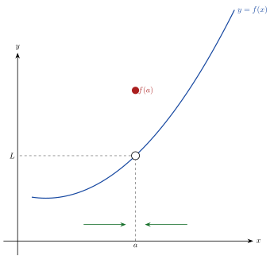
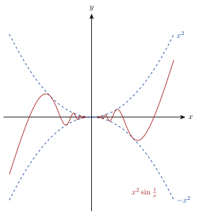

<!-- video: kommer (videoer/kalkulus/02-01-grenseverdier) -->
{fig-alt="Video kommer"}

<!-- tillegg: Claude -->
Hva er farten til en bil *akkurat nå*? Gjennomsnittsfarten over et tidsintervall er strekning delt på tid. Gjør vi intervallet kortere og kortere, nærmer gjennomsnittsfarten seg et bestemt tall. Det tallet er farten i øyeblikket, og det er en **grenseverdi**. Både den deriverte og integralet er grenseverdier, så dette er grunnmuren i kalkulus.

## Idéen

::: {.callout-note title="Definisjon: Grenseverdi (uformelt)"}
Vi skriver
$$
\lim_{x\to a} f(x) = L
$$
hvis $f(x)$ kommer så nær $L$ vi vil når $x$ er nær nok $a$, **men $x \neq a$**.
:::

Det som skjer **i** punktet $a$, spiller ingen rolle. Funksjonen trenger ikke engang være definert der.

{.tikz-fig fig-alt="En kurve med et hull i punktet (a, L). Funksjonsverdien f(a) er et eget punkt over hullet. Piler langs x-aksen viser at x nærmer seg a fra venstre og fra høyre."}

Den uformelle definisjonen holder til å regne. Den presise versjonen, med $\varepsilon$ og $\delta$, står på siden om [den formelle definisjonen](02-formell-definisjon.qmd).

::: {.eksempel}
**Eksempel: En brøk som blir 0/0.** Finn $\displaystyle\lim_{x\to 2}\frac{x^2 - 4}{x - 2}$.

::: {.losning}
Setter vi inn $x = 2$, får vi $\tfrac00$, som ikke betyr noe. Men for $x \neq 2$ kan vi forkorte:
$$
\frac{x^2 - 4}{x - 2} = \frac{(x - 2)(x + 2)}{x - 2} = x + 2 .
$$
Grenseverdien ser bare på $x \neq 2$, så
$$
\lim_{x\to 2}\frac{x^2 - 4}{x - 2} = \lim_{x\to 2}(x + 2) = \underline{\underline{4}} .
$$
Grafen til brøken er linja $y = x + 2$ med et hull i $(2, 4)$.
:::
:::

## Regneregler

Grenseverdier oppfører seg pent med de vanlige regneartene. Hvis $\lim\limits_{x\to a} f(x) = L$ og $\lim\limits_{x\to a} g(x) = M$, er

::: {.kort}
- **Sum og differanse** $\lim\,(f \pm g) = L \pm M$
- **Konstant faktor** $\lim\,(c\,f) = c\,L$
- **Produkt** $\lim\,(f\,g) = L\,M$
- **Kvotient** $\lim\,\dfrac{f}{g} = \dfrac{L}{M}$ hvis $M \neq 0$
- **Potens og rot** $\lim\,f^n = L^n$ og $\lim\sqrt[n]{f} = \sqrt[n]{L}$ (for partall $n$ må $L > 0$)
:::

For polynomer og rasjonale funksjoner (der nevneren ikke er null) betyr reglene at vi bare kan **sette inn** $x = a$. Det er når vi får $\tfrac00$ at vi må gjøre noe: faktorisere og forkorte, utvide med den konjugerte, eller skrive om.

::: {.eksempel}
**Eksempel: Utvid med den konjugerte.** Finn $\displaystyle\lim_{x\to 0}\frac{\sqrt{x + 9} - 3}{x}$.

::: {.losning}
Innsetting gir $\tfrac00$. Vi ganger med $\sqrt{x + 9} + 3$ over og under:
$$
\frac{\sqrt{x + 9} - 3}{x}\cdot\frac{\sqrt{x + 9} + 3}{\sqrt{x + 9} + 3} = \frac{(x + 9) - 9}{x\left(\sqrt{x + 9} + 3\right)} = \frac{1}{\sqrt{x + 9} + 3} .
$$
Nå kan vi sette inn:
$$
\lim_{x\to 0}\frac{1}{\sqrt{x + 9} + 3} = \frac{1}{3 + 3} = \underline{\underline{\frac16}} .
$$
:::
:::

## Ensidige grenser

Noen ganger nærmer funksjonen seg forskjellige verdier fra hver side. Da ser vi på **ensidige grenser**: $\lim\limits_{x\to a^-} f(x)$ når $x$ kommer fra venstre ($x < a$) og $\lim\limits_{x\to a^+} f(x)$ når $x$ kommer fra høyre ($x > a$).

::: {.callout-important title="Grensen finnes bare når sidene er enige"}
$$
\lim_{x\to a} f(x) = L \quad\Longleftrightarrow\quad \lim_{x\to a^-} f(x) = L \ \text{ og } \ \lim_{x\to a^+} f(x) = L .
$$
:::

::: {.eksempel}
**Eksempel: Absoluttverdi.** Finn $\displaystyle\lim_{x\to 0}\frac{|x|}{x}$, om den finnes.

::: {.losning}
For $x > 0$ er $|x| = x$, så brøken er $1$. For $x < 0$ er $|x| = -x$, så brøken er $-1$:
$$
\lim_{x\to 0^+}\frac{|x|}{x} = 1, \qquad \lim_{x\to 0^-}\frac{|x|}{x} = -1 .
$$
De ensidige grensene er forskjellige, så $\displaystyle\lim_{x\to 0}\frac{|x|}{x}$ **finnes ikke**.
:::
:::

## Skviseteoremet

Noen funksjoner er for kronglete til å regne direkte, men vi kan klemme dem mellom to enklere funksjoner.

::: {.callout-important title="Skviseteoremet"}
Hvis $g(x) \leq f(x) \leq h(x)$ for alle $x$ nær $a$ (unntatt kanskje i $a$), og
$$
\lim_{x\to a} g(x) = \lim_{x\to a} h(x) = L,
$$
så er også $\displaystyle\lim_{x\to a} f(x) = L$.
:::

{.tikz-fig fig-alt="Grafen til x i andre ganger sinus av 1 delt på x svinger mellom de to parablene y = x i andre og y = minus x i andre, og blir klemt mot null i origo."}

::: {.eksempel}
**Eksempel: Klemt mot null.** Vis at $\displaystyle\lim_{x\to 0} x^2\sin\frac1x = 0$.

::: {.losning}
Vi kan ikke bruke produktregelen, fordi $\lim\limits_{x\to 0}\sin\frac1x$ ikke finnes (sinus svinger mellom $-1$ og $1$ uendelig mange ganger). Men $-1 \leq \sin\frac1x \leq 1$, så
$$
-x^2 \leq x^2\sin\frac1x \leq x^2 .
$$
Både $-x^2$ og $x^2$ går mot $0$, så skviseteoremet gir $\displaystyle\lim_{x\to 0} x^2\sin\frac1x = 0$.
:::
:::

Den viktigste anvendelsen er en grense vi trenger for å derivere sinus:

::: {.callout-important title="En viktig grenseverdi"}
$$
\lim_{x\to 0}\frac{\sin x}{x} = 1 \qquad (x \text{ i radianer})
$$
:::

Geometrisk: For $0 < x < \tfrac{\pi}{2}$ ligger buen med lengde $x$ på enhetssirkelen mellom den loddrette kateten $\sin x$ og tangentstykket $\tan x$, og arealene av de tilhørende trekantene og sektoren gir $\cos x \leq \dfrac{\sin x}{x} \leq 1$. Begge sider går mot $1$. Tabellen under viser det samme numerisk.

## Prøv selv

```{.python .kjor}
import numpy as np

for x in [0.5, 0.1, 0.01, 0.001]:
    print(f"x = {x:6}:  sin(x)/x = {np.sin(x)/x:.8f}    (sqrt(x+9)-3)/x = {(np.sqrt(x+9)-3)/x:.8f}")
# Prøv grader i stedet for radianer: np.sin(np.radians(x))/x. Hva nærmer det seg da?
```

:::: {.oppgaver}

::: {.oppgave tittel="Regn ut grensene"}
a) $\displaystyle\lim_{x\to 3}\frac{x^2 - x - 6}{x - 3}$ b) $\displaystyle\lim_{x\to -1}\frac{x^3 + 1}{x + 1}$ c) $\displaystyle\lim_{h\to 0}\frac{(2 + h)^2 - 4}{h}$

::: {.losning}
a) $\dfrac{(x - 3)(x + 2)}{x - 3} = x + 2 \to \underline{\underline{5}}$

b) $x^3 + 1 = (x + 1)(x^2 - x + 1)$, så grensen er $1 + 1 + 1 = \underline{\underline{3}}$.

c) $\dfrac{4 + 4h + h^2 - 4}{h} = 4 + h \to \underline{\underline{4}}$. Dette er den deriverte av $x^2$ i $x = 2$.
:::
:::

::: {.oppgave tittel="Med sin x / x"}
Bruk $\lim\limits_{x\to 0}\dfrac{\sin x}{x} = 1$ til å finne

a) $\displaystyle\lim_{x\to 0}\frac{\sin 5x}{x}$ b) $\displaystyle\lim_{x\to 0}\frac{\tan x}{x}$ c) $\displaystyle\lim_{x\to 0}\frac{1 - \cos x}{x^2}$

::: {.losning}
a) $\dfrac{\sin 5x}{x} = 5\cdot\dfrac{\sin 5x}{5x} \to 5\cdot 1 = \underline{\underline{5}}$

b) $\dfrac{\tan x}{x} = \dfrac{\sin x}{x}\cdot\dfrac{1}{\cos x} \to 1\cdot 1 = \underline{\underline{1}}$

c) Gang med $1 + \cos x$ over og under:
$$
\frac{1 - \cos^2 x}{x^2(1 + \cos x)} = \left(\frac{\sin x}{x}\right)^2\frac{1}{1 + \cos x} \to 1\cdot\frac12 = \underline{\underline{\frac12}} .
$$
:::
:::

::: {.oppgave tittel="Ensidige grenser" niva="Middels"}
La $f(x) = \begin{cases} x^2 + 1, & x < 1 \\ 3 - kx, & x \geq 1 \end{cases}$.

Finn de ensidige grensene i $x = 1$. For hvilken $k$ finnes $\lim\limits_{x\to 1} f(x)$?

::: {.losning}
$\lim\limits_{x\to 1^-} f(x) = 1 + 1 = 2$ og $\lim\limits_{x\to 1^+} f(x) = 3 - k$. Grensen finnes når $3 - k = 2$, altså $\underline{\underline{k = 1}}$.
:::
:::

::: {.oppgave tittel="Skvis" niva="Utfordrende"}
Vis at $\displaystyle\lim_{x\to\infty}\frac{\cos x}{x} = 0$ og at $\displaystyle\lim_{x\to 0}\sqrt{|x|}\,\cos\!\left(\frac{1}{x^2}\right) = 0$.

::: {.losning}
For $x > 0$ er $-\dfrac1x \leq \dfrac{\cos x}{x} \leq \dfrac1x$, og begge sider går mot $0$ når $x \to \infty$.

Siden $\left|\cos\frac{1}{x^2}\right| \leq 1$, er $-\sqrt{|x|} \leq \sqrt{|x|}\cos\frac{1}{x^2} \leq \sqrt{|x|}$, og $\sqrt{|x|} \to 0$ når $x \to 0$. Skviseteoremet gir grensen $0$ i begge tilfellene.
:::
:::

::::
