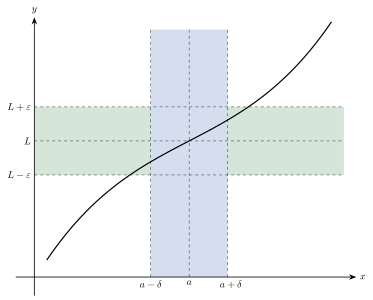

<!-- video: kommer (videoer/kalkulus/02-02-formell-definisjon) -->
{fig-alt="Video kommer"}

<!-- tillegg: Claude -->
«$f(x)$ kommer så nær $L$ vi vil når $x$ er nær nok $a$.» Hvor nær er *nær nok*? En maskinarbeider som skal dreie en aksel med diameter $20.00\ \mathrm{mm}$, får en toleranse, f.eks. $\pm 0.01\ \mathrm{mm}$. Spørsmålet er da hvor nøyaktig maskinen må stilles inn for å holde toleransen. Den formelle definisjonen av grenseverdi er nøyaktig det samme spillet: Noen gir en toleranse $\varepsilon$ på svaret, og vi må finne en toleranse $\delta$ på inndataene.

## Definisjonen

::: {.callout-note title="Definisjon: Grenseverdi"}
$\displaystyle\lim_{x\to a} f(x) = L$ betyr: For hver $\varepsilon > 0$ finnes en $\delta > 0$ slik at
$$
0 < |x - a| < \delta \quad\Longrightarrow\quad |f(x) - L| < \varepsilon .
$$
:::

Les det slik: Uansett hvor smalt bånd $(L - \varepsilon, L + \varepsilon)$ du legger rundt $L$, kan jeg finne et intervall $(a - \delta, a + \delta)$ rundt $a$ der hele grafen (unntatt kanskje i $a$) ligger inne i båndet. Kravet $0 < |x - a|$ sier at punktet $x = a$ selv ikke teller.

{.tikz-fig fig-alt="En voksende kurve. Et vannrett bånd mellom L minus epsilon og L pluss epsilon, og et loddrett bånd mellom a minus delta og a pluss delta. Der båndene krysser, ligger kurven inne i det vannrette båndet."}

Et mindre $\varepsilon$ krever som regel et mindre $\delta$. Poenget er at det **alltid** går, uansett hvor lite $\varepsilon$ er.

## Å vise en grense med ε og δ

Et bevis har alltid samme form: Gitt en vilkårlig $\varepsilon > 0$, finn en $\delta$ (som får avhenge av $\varepsilon$), og vis at den virker. Kladden går baklengs, fra $|f(x) - L| < \varepsilon$ til en betingelse på $|x - a|$.

::: {.eksempel}
**Eksempel: En lineær funksjon.** Vis at $\displaystyle\lim_{x\to 2}(3x - 1) = 5$.

::: {.losning}
*Kladd:* Vi vil ha $|(3x - 1) - 5| < \varepsilon$, altså $|3x - 6| = 3|x - 2| < \varepsilon$, altså $|x - 2| < \dfrac{\varepsilon}{3}$.

*Bevis:* La $\varepsilon > 0$ være gitt, og velg $\delta = \dfrac{\varepsilon}{3}$. Hvis $0 < |x - 2| < \delta$, er
$$
|(3x - 1) - 5| = 3|x - 2| < 3\delta = \varepsilon .
$$
Med $\varepsilon = 0.01$ må vi altså holde $x$ innenfor $\delta = 0.0033$ fra $2$.
:::
:::

For en rett linje er $\delta$ toleransen delt på stigningstallet. Det er ingen tilfeldighet: Nær et punkt oppfører pene funksjoner seg nesten som en rett linje, og stigningstallet bestemmer hvor følsomt svaret er for feil i inndataene.

::: {.eksempel}
**Eksempel: En andregradsfunksjon.** Vis at $\displaystyle\lim_{x\to 3} x^2 = 9$.

::: {.losning}
*Kladd:* $|x^2 - 9| = |x - 3|\,|x + 3|$. Faktoren $|x - 3|$ kan vi gjøre liten. Faktoren $|x + 3|$ må vi begrense. Hvis vi krever $|x - 3| < 1$, er $2 < x < 4$, og da er $|x + 3| < 7$. Da er $|x^2 - 9| < 7|x - 3|$, som er mindre enn $\varepsilon$ når $|x - 3| < \dfrac{\varepsilon}{7}$.

*Bevis:* La $\varepsilon > 0$, og velg $\delta = \min\!\left(1, \dfrac{\varepsilon}{7}\right)$. Hvis $0 < |x - 3| < \delta$, er $|x - 3| < 1$, så $|x + 3| < 7$, og
$$
|x^2 - 9| = |x - 3|\,|x + 3| < \frac{\varepsilon}{7}\cdot 7 = \varepsilon .
$$
:::
:::

Trikset med $\min(1, \ldots)$ er standard: Først låser vi $x$ til et område der den brysomme faktoren er begrenset, og så gjør vi resten liten.

## Når grensen ikke finnes

Å vise at en grense **ikke** finnes, er å vise at det finnes én $\varepsilon$ der ingen $\delta$ virker.

::: {.eksempel}
**Eksempel: Et sprang.** La $H(x) = 0$ for $x < 0$ og $H(x) = 1$ for $x \geq 0$ (Heaviside-funksjonen). Vis at $\lim\limits_{x\to 0} H(x)$ ikke finnes.

::: {.losning}
Anta at grensen er $L$. Velg $\varepsilon = \tfrac12$. Uansett hvor liten $\delta$ er, inneholder intervallet $(-\delta, \delta)$ både punkter der $H = 0$ og punkter der $H = 1$. Da må både $|0 - L| < \tfrac12$ og $|1 - L| < \tfrac12$. Men avstanden mellom $0$ og $1$ er $1$, så
$$
1 = |1 - 0| \leq |1 - L| + |L - 0| < \tfrac12 + \tfrac12 = 1,
$$
som er umulig. Ingen $L$ virker, så grensen finnes ikke.
:::
:::

## Hvorfor bry seg?

Regnereglene for grenseverdier, skviseteoremet og alt om kontinuitet bevises med denne definisjonen. Den gjør også «uendelig nær» unødvendig: Alt vi sier, handler om vanlige, positive tall $\varepsilon$ og $\delta$. Og den er det matematiske språket for **toleranser**, som ingeniører bruker hele tiden.

::: {.callout-tip title="Til ettertanke"}
I definisjonen kommer $\varepsilon$ først, og så $\delta$. Hva ville det betydd om rekkefølgen var motsatt: «Det finnes en $\delta$ slik at for alle $\varepsilon$ …»? Ville noen funksjoner oppfylle det?
:::

## Prøv selv

Programmet finner (numerisk) den største $\delta$ som virker for $f(x) = x^2$ i $a = 3$ for en gitt $\varepsilon$, og sammenligner med $\delta = \min(1, \varepsilon/7)$ fra beviset.

```{.python .kjor}
import numpy as np

f, a, L = (lambda x: x**2), 3.0, 9.0
for eps in [1.0, 0.1, 0.01, 0.001]:
    delta = 1.0
    while True:                                   # krymp delta til det virker på et fint rutenett
        x = np.linspace(a - delta, a + delta, 20001)
        if np.all(np.abs(f(x) - L) < eps): break
        delta *= 0.99
    print(f"eps = {eps:6}:  største delta ≈ {delta:.5f},   min(1, eps/7) = {min(1, eps/7):.5f}")
```

Beviset gir en $\delta$ som er litt for forsiktig, men det gjør ingenting. Det holder at **en** $\delta$ virker.

:::: {.oppgaver}

::: {.oppgave tittel="Finn δ"}
For $\displaystyle\lim_{x\to 1}(5 - 2x) = 3$: Hvilken $\delta$ virker når $\varepsilon = 0.1$? Gi en $\delta$ som virker for alle $\varepsilon$.

::: {.losning}
$|(5 - 2x) - 3| = |2 - 2x| = 2|x - 1| < \varepsilon$ når $|x - 1| < \dfrac{\varepsilon}{2}$. Med $\varepsilon = 0.1$ virker $\delta = 0.05$. Generelt virker $\delta = \dfrac{\varepsilon}{2}$.
:::
:::

::: {.oppgave tittel="Bevis" niva="Middels"}
Vis med definisjonen at $\displaystyle\lim_{x\to -1}(x^2 + 2x) = -1$.

::: {.losning}
$|x^2 + 2x + 1| = (x + 1)^2 = |x + 1|^2$. Velg $\delta = \sqrt{\varepsilon}$. Hvis $0 < |x + 1| < \delta$, er $|x^2 + 2x - (-1)| = |x + 1|^2 < \delta^2 = \varepsilon$.
:::
:::

::: {.oppgave tittel="Akselen" niva="Middels"}
Arealet av tverrsnittet av en aksel er $A = \dfrac{\pi d^2}{4}$. Den nominelle diameteren er $d = 20.00\ \mathrm{mm}$. Hvor nøyaktig må diameteren lages for at arealet skal avvike mindre enn $1.0\ \mathrm{mm^2}$ fra $\dfrac{\pi\cdot 20.00^2}{4}\ \mathrm{mm^2}$?

::: {.losning}
$|A - A_0| = \dfrac{\pi}{4}|d^2 - 20^2| = \dfrac{\pi}{4}|d - 20|\,|d + 20|$. Krever vi $|d - 20| < 1$, er $|d + 20| < 41$, og da er $|A - A_0| < \dfrac{41\pi}{4}|d - 20|$. Det er mindre enn $1.0$ når
$$
|d - 20| < \frac{4}{41\pi}\ \mathrm{mm} = 0.031\ \mathrm{mm} .
$$
En toleranse på $\underline{\underline{\pm 0.03\ \mathrm{mm}}}$ holder. (Regner vi eksakt, er toleransen ca. $0.0318\ \mathrm{mm}$ på hver side, så overslaget er godt.)
:::
:::

::: {.oppgave tittel="1/x" niva="Utfordrende"}
Vis med definisjonen at $\displaystyle\lim_{x\to 2}\frac1x = \frac12$. Tips: Begrens først $x$ til $|x - 2| < 1$.

::: {.losning}
$\left|\dfrac1x - \dfrac12\right| = \dfrac{|2 - x|}{2|x|}$. Med $|x - 2| < 1$ er $x > 1$, så $\dfrac{1}{2|x|} < \dfrac12$. Da er $\left|\dfrac1x - \dfrac12\right| < \dfrac{|x - 2|}{2}$, som er mindre enn $\varepsilon$ når $|x - 2| < 2\varepsilon$. Velg $\delta = \min(1, 2\varepsilon)$.
:::
:::

::::
