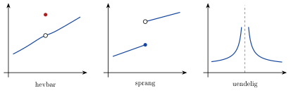
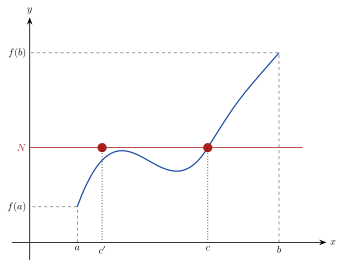

<!-- video: kommer (videoer/kalkulus/02-03-kontinuitet) -->
{fig-alt="Video kommer"}

<!-- tillegg: Claude -->
Temperaturen ute går fra $-3\ ^\circ\mathrm{C}$ om natta til $5\ ^\circ\mathrm{C}$ om dagen. Da må den ha vært nøyaktig $0\ ^\circ\mathrm{C}$ en gang i mellom. Det virker opplagt, men det bygger på at temperaturen endrer seg **kontinuerlig**, uten sprang. Kontinuitet er egenskapen som gjør at slike resonnementer holder.

## Definisjon

::: {.callout-note title="Definisjon: Kontinuitet i et punkt"}
$f$ er **kontinuerlig i** $x = a$ hvis
$$
\lim_{x\to a} f(x) = f(a) .
$$
Det betyr tre ting: $f(a)$ er definert, grensen finnes, og de to er like.
:::

$f$ er kontinuerlig på et intervall hvis den er kontinuerlig i hvert punkt av intervallet (i et lukket endepunkt holder det med den ensidige grensen innover).

Regnereglene for grenser gir at summer, produkter og sammensetninger av kontinuerlige funksjoner er kontinuerlige, og kvotienter er det der nevneren ikke er null. Dermed er alle de vanlige funksjonene kontinuerlige der de er definert: polynomer, rasjonale funksjoner, røtter, $\mathrm{e}^x$, $\ln x$, $\sin x$, $\cos x$, $\tan x$ og arcusfunksjonene.

## Hvordan en funksjon kan svikte

{.tikz-fig fig-alt="Tre små grafer. Den første har et hull i kurven og funksjonsverdien som et punkt utenfor. Den andre hopper fra en verdi til en annen. Den tredje går mot uendelig på begge sider av en loddrett linje."}

::: {.kort}
- **Hevbar diskontinuitet** Grensen finnes, men er ikke lik $f(a)$, eller $f(a)$ er ikke definert. Kan repareres ved å (om)definere $f(a)$.
- **Sprang** De ensidige grensene finnes, men er forskjellige.
- **Uendelig diskontinuitet** Minst én ensidig grense er $\pm\infty$.
:::

::: {.eksempel}
**Eksempel: Tett hullet.** Funksjonen $f(x) = \dfrac{\sin x}{x}$ er ikke definert i $x = 0$. Kan vi definere $f(0)$ slik at $f$ blir kontinuerlig på hele $\mathbb{R}$?

::: {.losning}
Ja. Fordi $\lim\limits_{x\to 0}\dfrac{\sin x}{x} = 1$, blir funksjonen
$$
f(x) = \begin{cases} \dfrac{\sin x}{x}, & x \neq 0 \\[2mm] 1, & x = 0 \end{cases}
$$
kontinuerlig også i $0$. Diskontinuiteten var hevbar.
:::
:::

::: {.eksempel}
**Eksempel: Velg konstanten.** For hvilken $c$ er
$$
f(x) = \begin{cases} c\,x^2 + 1, & x < 2 \\ 3x - c, & x \geq 2 \end{cases}
$$
kontinuerlig?

::: {.losning}
Begge delene er polynomer, så det eneste kritiske punktet er $x = 2$. Der er
$$
\lim_{x\to 2^-} f(x) = 4c + 1, \qquad \lim_{x\to 2^+} f(x) = f(2) = 6 - c .
$$
Kontinuitet krever $4c + 1 = 6 - c$, altså $\underline{\underline{c = 1}}$.
:::
:::

## Skjæringssetningen

::: {.callout-important title="Skjæringssetningen"}
Hvis $f$ er kontinuerlig på $[a, b]$ og $N$ er et tall mellom $f(a)$ og $f(b)$, så finnes minst én $c$ i $(a, b)$ med $f(c) = N$.
:::

{.tikz-fig fig-alt="En kontinuerlig kurve som starter under den vannrette linja y = N i x = a og slutter over den i x = b. Den krysser linja i to punkter, c merket og c."}

Setningen sier at en løsning **finnes**, ikke hvor den er eller hvor mange det er. Det viktigste spesialtilfellet: Har $f(a)$ og $f(b)$ motsatt fortegn, har $f(x) = 0$ en løsning i $(a, b)$. Halverer vi intervallet gang på gang og beholder halvdelen der fortegnet skifter, får vi **halveringsmetoden**, en enkel og sikker måte å løse likninger på.

::: {.eksempel}
**Eksempel: Vis at likningen har en løsning.** Vis at $\cos x = x$ har en løsning mellom $0$ og $1$.

::: {.losning}
La $f(x) = \cos x - x$, som er kontinuerlig. Da er
$$
f(0) = 1 > 0, \qquad f(1) = \cos 1 - 1 = -0.46 < 0 .
$$
Fortegnet skifter, så skjæringssetningen gir en $c$ i $(0, 1)$ med $f(c) = 0$, altså $\cos c = c$.
:::
:::

## Ekstremalverdisetningen

::: {.callout-important title="Ekstremalverdisetningen"}
En kontinuerlig funksjon på et **lukket og begrenset** intervall $[a, b]$ har både en største og en minste verdi der.
:::

Begge kravene trengs. Funksjonen $f(x) = \dfrac1x$ på $(0, 1]$ har ingen største verdi (intervallet er ikke lukket). Funksjonen $f(x) = x$ på $[0, \infty)$ har heller ingen (intervallet er ikke begrenset). Setningen er grunnen til at vi i [optimering](../04-anvendelser-derivasjon/05-optimering.qmd) kan være sikre på at svaret finnes når vi leter på et lukket intervall.

## Prøv selv

Halveringsmetoden på $\cos x = x$. Hvor mange halveringer trengs for seks korrekte desimaler?

```{.python .kjor}
import numpy as np

f = lambda x: np.cos(x) - x
a, b = 0.0, 1.0
for n in range(1, 25):
    c = (a + b) / 2
    if f(a) * f(c) <= 0: b = c       # fortegnsskiftet er i venstre halvdel
    else: a = c
    if n % 4 == 0: print(f"{n:2d} halveringer: x i [{a:.8f}, {b:.8f}]")
print("løsning ≈", (a + b) / 2)
```

Etter $n$ halveringer er intervallet $2^{-n}$ langt, så $20$ halveringer gir en feil mindre enn $10^{-6}$.

:::: {.oppgaver}

::: {.oppgave tittel="Hvor er funksjonen diskontinuerlig?"}
Finn og klassifiser diskontinuitetene til $f(x) = \dfrac{x^2 - 1}{x^2 - 3x + 2}$.

::: {.losning}
$f(x) = \dfrac{(x - 1)(x + 1)}{(x - 1)(x - 2)}$ er ikke definert i $x = 1$ og $x = 2$.

I $x = 1$: For $x \neq 1$ er $f(x) = \dfrac{x + 1}{x - 2} \to \dfrac{2}{-1} = -2$. Grensen finnes, så diskontinuiteten er **hevbar**.

I $x = 2$: Telleren går mot $3$ og nevneren mot $0$, så $f(x) \to \pm\infty$. **Uendelig** diskontinuitet.
:::
:::

::: {.oppgave tittel="To konstanter" niva="Middels"}
Finn $a$ og $b$ slik at $f$ blir kontinuerlig på $\mathbb{R}$:
$$
f(x) = \begin{cases} x + 1, & x < 1 \\ a x^2 + b, & 1 \leq x < 2 \\ 3x, & x \geq 2 \end{cases}
$$

::: {.losning}
I $x = 1$: $2 = a + b$. I $x = 2$: $4a + b = 6$. Trekker vi den første fra den andre, får vi $3a = 4$, så $\underline{\underline{a = \tfrac43}}$ og $\underline{\underline{b = \tfrac23}}$.
:::
:::

::: {.oppgave tittel="En likning med polynom" niva="Middels"}
Vis at $x^5 - 3x + 1 = 0$ har minst tre reelle løsninger.

::: {.losning}
La $f(x) = x^5 - 3x + 1$. Da er $f(-2) = -32 + 6 + 1 = -25$, $f(0) = 1$, $f(1) = -1$ og $f(2) = 32 - 6 + 1 = 27$. Fortegnet skifter på $(-2, 0)$, $(0, 1)$ og $(1, 2)$, så skjæringssetningen gir en løsning i hvert av de tre intervallene.
:::
:::

::: {.oppgave tittel="Antipodene" niva="Utfordrende"}
Vis at det til enhver tid finnes to punkter på ekvator, rett overfor hverandre, med nøyaktig samme temperatur. Anta at temperaturen $T(\theta)$ er en kontinuerlig funksjon av lengdegraden $\theta$.

::: {.losning}
La $g(\theta) = T(\theta) - T(\theta + \pi)$, som er kontinuerlig. Da er
$$
g(\theta + \pi) = T(\theta + \pi) - T(\theta + 2\pi) = T(\theta + \pi) - T(\theta) = -g(\theta),
$$
fordi $\theta + 2\pi$ er samme sted som $\theta$. Er $g(0) = 0$, er vi ferdige. Ellers har $g(0)$ og $g(\pi)$ motsatt fortegn, og skjæringssetningen gir en $c$ mellom $0$ og $\pi$ med $g(c) = 0$, altså $T(c) = T(c + \pi)$.
:::
:::

::::
