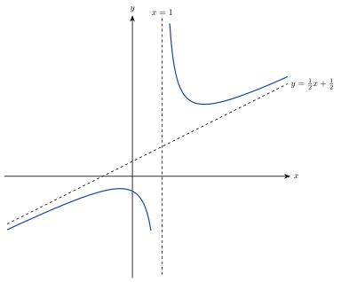

<!-- video: kommer (videoer/kalkulus/02-04-asymptoter) -->
{fig-alt="Video kommer"}

<!-- tillegg: Claude -->
En kopp kaffe avkjøles mot romtemperaturen, men når den aldri helt. En stein som faller gjennom luft, nærmer seg en terminalfart. I begge tilfellene er det oppførselen for **store verdier** av tiden vi spør etter. Grensene mot uendelig, og linjene grafen nærmer seg, kalles **asymptoter**.

## Grenser når x går mot uendelig

$\displaystyle\lim_{x\to\infty} f(x) = L$ betyr at $f(x)$ kommer så nær $L$ vi vil når $x$ er stor nok. Da er linja $y = L$ en **vannrett asymptote**.

For rasjonale funksjoner deler vi teller og nevner med den høyeste potensen av $x$ i nevneren. Da står det ledd som $\dfrac{1}{x}$, $\dfrac{1}{x^2}$ igjen, og de går mot $0$.

::: {.eksempel}
**Eksempel: Rasjonal funksjon.** Finn $\displaystyle\lim_{x\to\infty}\frac{3x^2 - 5x + 1}{2x^2 + 7}$.

::: {.losning}
Del på $x^2$ over og under:
$$
\frac{3 - \dfrac5x + \dfrac{1}{x^2}}{2 + \dfrac{7}{x^2}} \to \frac{3 - 0 + 0}{2 + 0} = \underline{\underline{\frac32}} .
$$
Linja $y = \tfrac32$ er en vannrett asymptote.
:::
:::

For rasjonale funksjoner er det gradene som bestemmer:

::: {.kort}
- **Høyest grad i nevneren** Grensen er $0$.
- **Samme grad** Grensen er forholdet mellom koeffisientene foran de høyeste potensene.
- **Høyest grad i telleren** Funksjonen går mot $\pm\infty$. Er graden én høyere, finnes en skrå asymptote.
:::

## Hvem vinner?

Når vi sammenligner funksjoner for store $x$, vokser logaritmer langsommere enn enhver potens, og eksponentialfunksjoner raskere enn enhver potens:
$$
\lim_{x\to\infty}\frac{\ln x}{x^p} = 0, \qquad \lim_{x\to\infty}\frac{x^p}{\mathrm{e}^x} = 0 \qquad (p > 0) .
$$
Vi kan bevise dem med [L'Hôpitals regel](../04-anvendelser-derivasjon/03-lhopital.qmd). Prøv selv: $\dfrac{x^{10}}{\mathrm{e}^x}$ er over en milliard for $x = 30$, men går likevel mot null.

## Vertikale asymptoter

Linja $x = a$ er en **vertikal asymptote** hvis $f(x) \to \pm\infty$ når $x \to a^-$ eller $x \to a^+$. For en rasjonal funksjon skjer det der nevneren er null og telleren ikke er det (etter at felles faktorer er forkortet).

## Skrå asymptoter

Er graden i telleren én høyere enn i nevneren, gir polynomdivisjon
$$
f(x) = ax + b + r(x), \qquad r(x) \to 0 \text{ når } x \to \pm\infty .
$$
Da nærmer grafen seg linja $y = ax + b$, som er en **skrå asymptote**.

{.tikz-fig fig-alt="En graf med to greiner på hver side av den loddrette linja x = 1. Begge greinene nærmer seg den skrå linja y = en halv x pluss en halv langt ute."}

::: {.eksempel}
**Eksempel: Alle asymptotene.** Finn asymptotene til $f(x) = \dfrac{x^2 + 1}{2(x - 1)}$.

::: {.losning}
*Vertikal:* Nevneren er null i $x = 1$, og telleren er $2 \neq 0$ der. Fortegnet gir $f(x) \to -\infty$ når $x \to 1^-$ og $f(x) \to \infty$ når $x \to 1^+$. Linja $x = 1$ er en vertikal asymptote.

*Skrå:* Polynomdivisjon gir $x^2 + 1 = (x - 1)(x + 1) + 2$, så
$$
f(x) = \frac{(x - 1)(x + 1) + 2}{2(x - 1)} = \frac12 x + \frac12 + \frac{1}{x - 1} .
$$
Det siste leddet går mot $0$ når $x \to \pm\infty$. Den skrå asymptoten er $y = \tfrac12 x + \tfrac12$. For $x > 1$ ligger grafen over asymptoten, for $x < 1$ under.
:::
:::

::: {.eksempel}
**Eksempel: Kaffen.** Temperaturen i en kaffekopp er $T(t) = 21 + 64\,\mathrm{e}^{-0.045t}$ (i $^\circ\mathrm{C}$, $t$ i minutter). Hva skjer i det lange løp, og når er kaffen innenfor $1\ ^\circ\mathrm{C}$ av grenseverdien?

::: {.losning}
Fordi $\mathrm{e}^{-0.045t} \to 0$, er $\displaystyle\lim_{t\to\infty} T(t) = 21\ ^\circ\mathrm{C}$, romtemperaturen. Linja $T = 21$ er en vannrett asymptote.

Vi vil ha $64\,\mathrm{e}^{-0.045t} < 1$:
$$
t > \frac{\ln 64}{0.045}\ \mathrm{min} = \frac{4.159}{0.045}\ \mathrm{min} = \underline{\underline{92\ \mathrm{min}}} .
$$
:::
:::

## Prøv selv

```{.python .kjor}
import numpy as np
import matplotlib.pyplot as plt

x1 = np.linspace(-4, 0.8, 300); x2 = np.linspace(1.2, 6, 300)
f = lambda x: (x**2 + 1) / (2 * (x - 1))
for x in (x1, x2): plt.plot(x, f(x), "C0")
xs = np.linspace(-4, 6, 2)
plt.plot(xs, 0.5 * xs + 0.5, "k--", label="y = x/2 + 1/2")
plt.axvline(1, color="gray", ls=":")
plt.ylim(-6, 8); plt.grid(alpha=0.3); plt.legend(); plt.show()

for x in [10, 100, 1000]:
    print(f"x = {x:5}:  f(x) - (x/2 + 1/2) = {f(x) - (0.5*x + 0.5):.6f}")
```

:::: {.oppgaver}

::: {.oppgave tittel="Grenser mot uendelig"}
a) $\displaystyle\lim_{x\to\infty}\frac{4x^3 - x}{1 - 2x^3}$ b) $\displaystyle\lim_{x\to -\infty}\frac{5x + 2}{x^2 + 1}$ c) $\displaystyle\lim_{x\to\infty}\left(\sqrt{x^2 + 6x} - x\right)$

::: {.losning}
a) Samme grad: $\dfrac{4}{-2} = \underline{\underline{-2}}$.

b) Høyest grad i nevneren: $\underline{\underline{0}}$.

c) Utvid med den konjugerte:
$$
\frac{(x^2 + 6x) - x^2}{\sqrt{x^2 + 6x} + x} = \frac{6x}{x\left(\sqrt{1 + 6/x} + 1\right)} \to \frac{6}{2} = \underline{\underline{3}} .
$$
:::
:::

::: {.oppgave tittel="Finn asymptotene"}
Finn alle asymptotene til $f(x) = \dfrac{2x^2 - 3x}{x + 1}$.

::: {.losning}
Vertikal: $x = -1$ (telleren er $5 \neq 0$ der).

Polynomdivisjon: $2x^2 - 3x = (x + 1)(2x - 5) + 5$, så $f(x) = 2x - 5 + \dfrac{5}{x + 1}$. Skrå asymptote: $\underline{\underline{y = 2x - 5}}$.
:::
:::

::: {.oppgave tittel="To vannrette asymptoter" niva="Middels"}
Vis at $f(x) = \dfrac{3x}{\sqrt{x^2 + 4}}$ har to forskjellige vannrette asymptoter.

::: {.losning}
$\sqrt{x^2 + 4} = |x|\sqrt{1 + 4/x^2}$. For $x > 0$ er $|x| = x$, og $f(x) = \dfrac{3}{\sqrt{1 + 4/x^2}} \to 3$. For $x < 0$ er $|x| = -x$, og $f(x) \to -3$. Asymptotene er $y = 3$ (når $x \to \infty$) og $y = -3$ (når $x \to -\infty$).
:::
:::

::: {.oppgave tittel="Terminalfart" niva="Middels"}
Farten til en liten kule som synker i olje, er $v(t) = v_\text{t}\left(1 - \mathrm{e}^{-t/\tau}\right)$ med $v_\text{t} = 0.12\ \mathrm{m/s}$ og $\tau = 0.25\ \mathrm{s}$.

a) Finn $\lim\limits_{t\to\infty} v(t)$ og tolk svaret.

b) Etter hvor lang tid er farten $99\ \%$ av grenseverdien?

::: {.losning}
a) $v(t) \to v_\text{t} = 0.12\ \mathrm{m/s}$, terminalfarten, der friksjonen fra oljen balanserer tyngden (minus oppdriften).

b) $1 - \mathrm{e}^{-t/\tau} = 0.99$ gir $\mathrm{e}^{-t/\tau} = 0.01$, så $t = \tau\ln 100 = 0.25\cdot 4.605\ \mathrm{s} = \underline{\underline{1.2\ \mathrm{s}}}$.
:::
:::

::::
