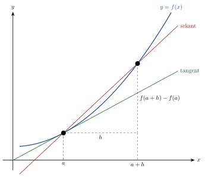

<!-- video: kommer (videoer/kalkulus/03-01-den-deriverte) -->
{fig-alt="Video kommer"}

<!-- tillegg: Claude -->
En ball slippes fra et tak og har falt $s(t) = 4.905\,t^2$ meter etter $t$ sekunder. Hvor fort faller den etter $2\ \mathrm{s}$? Gjennomsnittsfarten fra $t = 2$ til $t = 2 + h$ er
$$
\frac{s(2 + h) - s(2)}{h} = \frac{4.905\left(4 + 4h + h^2\right) - 4.905\cdot 4}{h} = 4.905\,(4 + h) .
$$
Når intervallet krymper ($h \to 0$), går dette mot $19.62\ \mathrm{m/s}$. Det er farten i øyeblikket $t = 2\ \mathrm{s}$, og det er **den deriverte** av $s$ i $t = 2$.

## Definisjon

::: {.callout-note title="Definisjon: Den deriverte"}
Den deriverte av $f$ i punktet $a$ er
$$
f'(a) = \lim_{h\to 0}\frac{f(a + h) - f(a)}{h},
$$
dersom grenseverdien finnes. Da sier vi at $f$ er **deriverbar** i $a$.
:::

Brøken kalles **differansekvotienten**. Geometrisk er den stigningstallet til **sekanten** gjennom $(a, f(a))$ og $(a + h, f(a + h))$. Når $h \to 0$, dreier sekanten seg mot **tangenten**, og $f'(a)$ er stigningstallet til tangenten.

{.tikz-fig fig-alt="En voksende kurve med en sekant gjennom punktene over a og a pluss h, og tangenten i punktet over a. Den vannrette avstanden er h og den loddrette er f(a + h) minus f(a)."}

::: {.callout-important title="Tangenten"}
Tangenten til grafen til $f$ i punktet $(a, f(a))$ er
$$
y = f(a) + f'(a)(x - a) .
$$
:::

Lar vi $a$ variere, får vi en ny funksjon, $f'(x)$. Andre skrivemåter er $\dfrac{\mathrm{d}f}{\mathrm{d}x}$, $\dfrac{\mathrm{d}y}{\mathrm{d}x}$ og, for tid, $\dot{s}$. Leibniz' notasjon $\dfrac{\mathrm{d}y}{\mathrm{d}x}$ minner om at den deriverte er en grense av $\dfrac{\Delta y}{\Delta x}$. Enheten er enheten til $y$ delt på enheten til $x$.

::: {.eksempel}
**Eksempel: Derivert fra definisjonen.** Finn $f'(x)$ for $f(x) = \dfrac1x$, og tangenten i $x = 2$.

::: {.losning}
$$
\frac{f(x + h) - f(x)}{h} = \frac{\dfrac{1}{x + h} - \dfrac1x}{h} = \frac{x - (x + h)}{h\,x(x + h)} = \frac{-1}{x(x + h)} .
$$
Når $h \to 0$, får vi
$$
f'(x) = -\frac{1}{x^2} .
$$
I $x = 2$ er $f(2) = \tfrac12$ og $f'(2) = -\tfrac14$, så tangenten er
$$
y = \frac12 - \frac14(x - 2) = -\frac14 x + 1 .
$$
:::
:::

::: {.eksempel}
**Eksempel: Kvadratroten.** Finn $\dfrac{\mathrm{d}}{\mathrm{d}x}\sqrt{x}$ for $x > 0$.

::: {.losning}
Utvid med den konjugerte:
$$
\frac{\sqrt{x + h} - \sqrt{x}}{h}\cdot\frac{\sqrt{x + h} + \sqrt{x}}{\sqrt{x + h} + \sqrt{x}} = \frac{h}{h\left(\sqrt{x + h} + \sqrt{x}\right)} = \frac{1}{\sqrt{x + h} + \sqrt{x}} \to \frac{1}{2\sqrt{x}} .
$$
:::
:::

## Deriverbar og kontinuerlig

::: {.callout-important title="Deriverbar betyr kontinuerlig"}
Er $f$ deriverbar i $a$, er $f$ også [kontinuerlig](../02-grenseverdier/03-kontinuitet.qmd) i $a$.
:::

Bevis: For $h \neq 0$ er
$$
f(a + h) - f(a) = \frac{f(a + h) - f(a)}{h}\cdot h \to f'(a)\cdot 0 = 0,
$$
så $f(a + h) \to f(a)$.

Det motsatte gjelder ikke. En funksjon kan være kontinuerlig uten å ha en tangent, enten fordi grafen har en **knekk** eller fordi tangenten er **loddrett**.

![Venstre: $|x|$ har en knekk i $0$, med stigningstall $-1$ til venstre og $1$ til høyre. Høyre: $\sqrt[3]{x}$ har en loddrett tangent i $0$.](../../bilder/figurer/abs-knekk.svg){.tikz-fig fig-alt="To grafer. Den første er V-formen til absoluttverdien med en spiss knekk i origo. Den andre er grafen til tredjeroten av x, som står loddrett i origo."}

For $f(x) = |x|$ i $0$ er differansekvotienten $\dfrac{|h|}{h}$, som er $1$ for $h > 0$ og $-1$ for $h < 0$. De ensidige grensene er forskjellige, så $f'(0)$ finnes ikke. For $\sqrt[3]{x}$ er differansekvotienten $h^{-2/3} \to \infty$.

## Høyere ordens deriverte

Den deriverte av den deriverte er **andrederiverte**, $f''(x)$ eller $\dfrac{\mathrm{d}^2 y}{\mathrm{d}x^2}$. Er $s(t)$ posisjon, er $s'(t) = v(t)$ farten og $s''(t) = a(t)$ akselerasjonen. For ballen over er $s'(t) = 9.81\,t$ og $s''(t) = 9.81\ \mathrm{m/s^2}$, tyngdeakselerasjonen. Newtons andre lov, $F = m\,s''(t)$, er en likning med den andrederiverte. Derfor er så mye av fysikken skrevet med derivasjon.

## Prøv selv

Programmet regner differansekvotienten for $\sin x$ i $x = 1$ med stadig mindre $h$. Hvilket tall nærmer den seg? Sammenlign med $\cos 1$. Hva skjer når $h$ blir *veldig* liten, f.eks. $10^{-12}$?

```{.python .kjor}
import numpy as np

f, a = np.sin, 1.0
for h in [1e-1, 1e-2, 1e-3, 1e-5, 1e-8, 1e-12]:
    print(f"h = {h:7.0e}:  (f(a+h) - f(a))/h = {(f(a + h) - f(a)) / h:.12f}")
print("cos(1)               =", f"{np.cos(1.0):.12f}")
```

For veldig små $h$ blir svaret dårligere igjen: Datamaskinen regner med omtrent 16 siffer, og $f(a + h) - f(a)$ blir en differanse mellom to nesten like tall.

:::: {.oppgaver}

::: {.oppgave tittel="Fra definisjonen"}
Bruk definisjonen til å finne $f'(x)$ for $f(x) = 3x^2 - 2x$. Finn tangenten i $x = 1$.

::: {.losning}
$$
\frac{3(x + h)^2 - 2(x + h) - 3x^2 + 2x}{h} = \frac{6xh + 3h^2 - 2h}{h} = 6x + 3h - 2 \to 6x - 2 .
$$
$f(1) = 1$ og $f'(1) = 4$, så tangenten er $y = 1 + 4(x - 1) = \underline{\underline{4x - 3}}$.
:::
:::

::: {.oppgave tittel="Les av grafen"}
Temperaturen i en ovn er $T(t)$ i $^\circ\mathrm{C}$, med $t$ i minutter. Hva betyr $T'(10) = 12$? Hvilken enhet har tallet? Omtrent hvor varm er ovnen etter $10.5$ minutter hvis $T(10) = 140\ ^\circ\mathrm{C}$?

::: {.losning}
Etter $10$ minutter stiger temperaturen med $12\ ^\circ\mathrm{C}$ per minutt. Enheten er $^\circ\mathrm{C/min}$. Et halvt minutt senere er temperaturen omtrent
$$
T(10.5) \approx 140 + 12\cdot 0.5 = \underline{\underline{146\ ^\circ\mathrm{C}}} .
$$
:::
:::

::: {.oppgave tittel="Deriverbar i skjøten?" niva="Middels"}
La $f(x) = x^2$ for $x \leq 1$ og $f(x) = ax + b$ for $x > 1$. Finn $a$ og $b$ slik at $f$ blir deriverbar i $x = 1$.

::: {.losning}
Kontinuitet: $1 = a + b$. Stigningstallet fra venstre er $2x = 2$ i $x = 1$, og fra høyre $a$. Deriverbarhet krever $a = 2$, og da er $b = -1$. Linja $y = 2x - 1$ er tangenten til $x^2$ i $x = 1$, så grafen fortsetter langs tangenten uten knekk.
:::
:::

::: {.oppgave tittel="Symmetrisk differansekvotient" niva="Utfordrende"}
Den symmetriske differansekvotienten er $\dfrac{f(a + h) - f(a - h)}{2h}$.

a) Vis at den gir eksakt $f'(a)$ for $f(x) = x^2$ for alle $h \neq 0$.

b) For $f(x) = x^3$: Finn feilen som funksjon av $h$, og sammenlign med feilen i den vanlige differansekvotienten.

::: {.losning}
a) $\dfrac{(a + h)^2 - (a - h)^2}{2h} = \dfrac{4ah}{2h} = 2a = f'(a)$.

b) $\dfrac{(a + h)^3 - (a - h)^3}{2h} = \dfrac{6a^2h + 2h^3}{2h} = 3a^2 + h^2$. Feilen er $h^2$.

Den vanlige gir $\dfrac{(a + h)^3 - a^3}{h} = 3a^2 + 3ah + h^2$, med feil $3ah + h^2$, som er proporsjonal med $h$ for små $h$. Den symmetriske er mye mer nøyaktig: Halverer vi $h$, blir feilen fire ganger mindre i stedet for to.
:::
:::

::::
