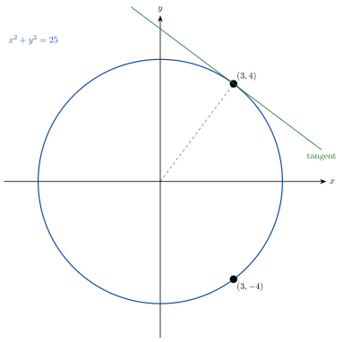

<!-- video: kommer (videoer/kalkulus/03-06-implisitt-derivasjon) -->
{fig-alt="Video kommer"}

<!-- tillegg: Claude -->
Sirkelen $x^2 + y^2 = 25$ er ikke grafen til én funksjon: Over hver $x$ ligger det to punkter. Likevel har sirkelen en tangent i hvert punkt. Mange kurver er gitt slik, ved en **likning** mellom $x$ og $y$, og ofte er det umulig å løse ut $y$. Implisitt derivasjon gir oss stigningstallet uten at vi løser ut noe.

## Metoden

Idéen er å tenke på $y$ som en (ukjent) funksjon av $x$ nær punktet vi ser på, og derivere hele likningen med hensyn på $x$. Hver gang vi deriverer noe med $y$ i, gir kjerneregelen en faktor $y'$.

::: {.steg}
1. **Deriver begge sider** av likningen med hensyn på $x$. Husk kjerneregelen: $\dfrac{\mathrm{d}}{\mathrm{d}x}\,y^2 = 2y\,y'$, $\dfrac{\mathrm{d}}{\mathrm{d}x}\sin y = \cos y\cdot y'$.
2. **Samle** alle ledd med $y'$ på én side.
3. **Løs ut** $y'$. Svaret inneholder typisk både $x$ og $y$.
4. **Sett inn** koordinatene til punktet.
:::

::: {.eksempel}
**Eksempel: Sirkelen.** Finn tangenten til $x^2 + y^2 = 25$ i punktet $(3, 4)$.

::: {.losning}
Deriver begge sider:
$$
2x + 2y\,y' = 0 \quad\Longrightarrow\quad y' = -\frac{x}{y} .
$$
I $(3, 4)$ er $y' = -\tfrac34$, og tangenten er
$$
y = 4 - \frac34(x - 3) = -\frac34 x + \frac{25}{4} .
$$
Kontroll: Radien til $(3, 4)$ har stigningstall $\tfrac43$, og $\tfrac43\cdot\left(-\tfrac34\right) = -1$, så tangenten står vinkelrett på radien, slik den skal.
:::
:::

{.tikz-fig fig-alt="Sirkelen x i andre pluss y i andre lik 25 med en tangent i punktet (3, 4), og radien fra origo til punktet. Punktet (3, -4) er også markert."}

Én formel dekker både øvre og nedre halvdel av sirkelen. Den svikter bare der $y = 0$, i $(\pm 5, 0)$, der tangenten er loddrett.

::: {.eksempel}
**Eksempel: En kurve vi ikke kan løse.** Finn $y'$ for kurven $x^3 + y^3 = 6xy$ (Descartes' blad), og tangenten i $(3, 3)$.

::: {.losning}
Høyresiden er et produkt, så vi trenger produktregelen:
$$
3x^2 + 3y^2\,y' = 6y + 6x\,y' .
$$
Samle $y'$:
$$
y'(3y^2 - 6x) = 6y - 3x^2 \quad\Longrightarrow\quad y' = \frac{2y - x^2}{y^2 - 2x} .
$$
I $(3, 3)$: $y' = \dfrac{6 - 9}{9 - 6} = -1$. Tangenten er $y = 3 - (x - 3) = -x + 6$.
:::
:::

## Andrederiverte

Vi kan derivere en gang til. Da kommer $y'$ inn i uttrykket, og vi setter inn det vi fant først.

::: {.eksempel}
**Eksempel: Krumning på sirkelen.** Finn $y''$ for $x^2 + y^2 = 25$.

::: {.losning}
Vi har $y' = -\dfrac{x}{y}$. Kvotientregelen:
$$
y'' = -\frac{1\cdot y - x\,y'}{y^2} = -\frac{y - x\left(-\dfrac{x}{y}\right)}{y^2} = -\frac{y^2 + x^2}{y^3} = -\frac{25}{y^3} .
$$
På øvre halvdel ($y > 0$) er $y'' < 0$, så kurven krummer nedover. På nedre halvdel er $y'' > 0$.
:::
:::

## Logaritmisk derivasjon

Noen funksjoner er mye enklere å derivere etter at vi har tatt logaritmen. Det gjelder lange produkter og kvotienter, og funksjoner der variabelen står i både grunntall og eksponent.

::: {.eksempel}
**Eksempel: x opphøyd i x.** Deriver $y = x^x$ for $x > 0$.

::: {.losning}
Verken potensregelen (eksponenten er ikke konstant) eller regelen for $a^x$ (grunntallet er ikke konstant) passer. Ta logaritmen:
$$
\ln y = x\ln x .
$$
Deriver begge sider implisitt:
$$
\frac{y'}{y} = \ln x + x\cdot\frac1x = \ln x + 1 \quad\Longrightarrow\quad y' = x^x(\ln x + 1) .
$$
:::
:::

::: {.eksempel}
**Eksempel: Et langt uttrykk.** Deriver $y = \dfrac{x^3\sqrt{x^2 + 1}}{(3x + 2)^5}$.

::: {.losning}
$$
\ln y = 3\ln x + \frac12\ln(x^2 + 1) - 5\ln(3x + 2) .
$$
$$
\frac{y'}{y} = \frac3x + \frac{x}{x^2 + 1} - \frac{15}{3x + 2}, \qquad y' = \frac{x^3\sqrt{x^2 + 1}}{(3x + 2)^5}\left(\frac3x + \frac{x}{x^2 + 1} - \frac{15}{3x + 2}\right) .
$$
:::
:::

## Prøv selv

Programmet tegner Descartes' blad og tangenten i $(3, 3)$. Endre punktet til et annet punkt på kurven, f.eks. $\left(\tfrac43, \tfrac83\right)$.

```{.python .kjor}
import numpy as np
import matplotlib.pyplot as plt

X, Y = np.meshgrid(np.linspace(-4, 5, 500), np.linspace(-4, 5, 500))
plt.contour(X, Y, X**3 + Y**3 - 6*X*Y, levels=[0], colors="C0")   # kurven F(x, y) = 0

x0, y0 = 3.0, 3.0
m = (2*y0 - x0**2) / (y0**2 - 2*x0)                                # implisitt derivasjon
x = np.linspace(0, 5, 2)
plt.plot(x, y0 + m*(x - x0), "C1", label=f"tangent, y' = {m:.3f}")
plt.plot(x0, y0, "ko"); plt.gca().set_aspect("equal"); plt.grid(alpha=0.3); plt.legend()
plt.show()
```

:::: {.oppgaver}

::: {.oppgave tittel="Finn y'"}
a) $x^2 - xy + y^2 = 7$ b) $\sin(x + y) = y$ c) $\mathrm{e}^{xy} = x + y$

::: {.losning}
a) $2x - y - x\,y' + 2y\,y' = 0$, så $y' = \dfrac{y - 2x}{2y - x}$.

b) $\cos(x + y)(1 + y') = y'$, så $y' = \dfrac{\cos(x + y)}{1 - \cos(x + y)}$.

c) $\mathrm{e}^{xy}(y + x\,y') = 1 + y'$, så $y' = \dfrac{1 - y\,\mathrm{e}^{xy}}{x\,\mathrm{e}^{xy} - 1}$.
:::
:::

::: {.oppgave tittel="Tangent til en ellipse"}
Finn tangenten til ellipsen $\dfrac{x^2}{16} + \dfrac{y^2}{9} = 1$ i punktet $\left(2, \tfrac{3\sqrt3}{2}\right)$.

::: {.losning}
$\dfrac{x}{8} + \dfrac{2y\,y'}{9} = 0$, så $y' = -\dfrac{9x}{16y}$. I punktet: $y' = -\dfrac{18}{16\cdot\tfrac{3\sqrt3}{2}} = -\dfrac{18}{24\sqrt3} = -\dfrac{\sqrt3}{4}$. Tangenten er
$$
y = \frac{3\sqrt3}{2} - \frac{\sqrt3}{4}(x - 2) = -\frac{\sqrt3}{4}x + 2\sqrt3 .
$$
:::
:::

::: {.oppgave tittel="Ideell gass" niva="Middels"}
For en gass ved konstant temperatur gjelder $pV = k$. Bruk implisitt derivasjon til å finne $\dfrac{\mathrm{d}p}{\mathrm{d}V}$. Hvis volumet minker med $1.0\ \%$, omtrent hvor mange prosent øker trykket?

::: {.losning}
$V\dfrac{\mathrm{d}p}{\mathrm{d}V} + p = 0$, så $\dfrac{\mathrm{d}p}{\mathrm{d}V} = -\dfrac{p}{V}$. Da er $\Delta p \approx -\dfrac{p}{V}\Delta V$, og $\dfrac{\Delta p}{p} \approx -\dfrac{\Delta V}{V} = -(-1.0\ \%) = \underline{\underline{1.0\ \%}}$.
:::
:::

::: {.oppgave tittel="Vannrette tangenter" niva="Utfordrende"}
Finn punktene på Descartes' blad $x^3 + y^3 = 6xy$ der tangenten er vannrett (utenom origo).

::: {.losning}
$y' = \dfrac{2y - x^2}{y^2 - 2x} = 0$ krever $2y = x^2$, altså $y = \tfrac{x^2}{2}$. Sett inn i kurven:
$$
x^3 + \frac{x^6}{8} = 3x^3 \quad\Longrightarrow\quad \frac{x^6}{8} = 2x^3 \quad\Longrightarrow\quad x^3 = 16 \ \ (x \neq 0) .
$$
Da er $x = \sqrt[3]{16} = 2\sqrt[3]{2} \approx 2.52$ og $y = \tfrac{x^2}{2} = 2\sqrt[3]{4} \approx 3.17$. Nevneren er $y^2 - 2x \approx 10.08 - 5.04 \neq 0$, så tangenten er vannrett i $\underline{\underline{\left(2\sqrt[3]{2},\ 2\sqrt[3]{4}\right)}}$.
:::
:::

::::
