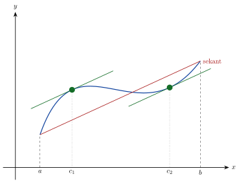

<!-- video: kommer (videoer/kalkulus/03-08-middelverdisetningen) -->
{fig-alt="Video kommer"}

<!-- tillegg: Claude -->
Du kjører $120\ \mathrm{km}$ på én time. Da må speedometeret ha vist nøyaktig $120\ \mathrm{km/h}$ minst én gang underveis, selv om du både har kjørt fortere og saktere. Det er middelverdisetningen: Et sted er farten i øyeblikket lik gjennomsnittsfarten. Setningen ser uskyldig ut, men den er nøkkelen til å bevise mye av det vi tar for gitt om deriverte.

## Rolles teorem

::: {.callout-important title="Rolles teorem"}
La $f$ være kontinuerlig på $[a, b]$ og deriverbar på $(a, b)$, med $f(a) = f(b)$. Da finnes en $c$ i $(a, b)$ med
$$
f'(c) = 0 .
$$
:::

En ball som kastes opp og lander i samme høyde, har et punkt der den vertikale farten er null: toppen. Bevis: Ifølge [ekstremalverdisetningen](../02-grenseverdier/03-kontinuitet.qmd) har $f$ en største og en minste verdi på $[a, b]$. Er begge i endepunktene, er $f$ konstant og $f' = 0$ overalt. Ellers ligger en av dem i et indre punkt $c$, og der er tangenten vannrett. (I et indre toppunkt er differansekvotienten $\geq 0$ fra venstre og $\leq 0$ fra høyre, så den deriverte må være $0$.)

## Middelverdisetningen

::: {.callout-important title="Middelverdisetningen"}
La $f$ være kontinuerlig på $[a, b]$ og deriverbar på $(a, b)$. Da finnes en $c$ i $(a, b)$ med
$$
f'(c) = \frac{f(b) - f(a)}{b - a} .
$$
:::

Høyresiden er stigningstallet til sekanten mellom endepunktene. Setningen sier at det finnes minst ett punkt der tangenten er **parallell** med sekanten.

{.tikz-fig fig-alt="En bølgete kurve fra a til b med en rett sekant mellom endepunktene. I to punkter, c1 og c2, er tangenten tegnet, og begge er parallelle med sekanten."}

Bevis: Trekk sekanten fra funksjonen. $g(x) = f(x) - \left(f(a) + \dfrac{f(b) - f(a)}{b - a}(x - a)\right)$ har $g(a) = g(b) = 0$, og Rolles teorem gir en $c$ med $g'(c) = 0$, som er nøyaktig påstanden.

::: {.eksempel}
**Eksempel: Finn punktet.** Finn $c$ i middelverdisetningen for $f(x) = x^3 - x$ på $[0, 2]$.

::: {.losning}
Sekanten har stigningstall $\dfrac{f(2) - f(0)}{2 - 0} = \dfrac{6 - 0}{2} = 3$. Vi løser $f'(c) = 3c^2 - 1 = 3$: $c^2 = \tfrac43$, så $c = \dfrac{2}{\sqrt3} \approx 1.15$, som ligger i $(0, 2)$. (Den negative løsningen ligger utenfor.)
:::
:::

## Hva vi kan bevise med den

Middelverdisetningen er verktøyet som kobler **lokal** informasjon (den deriverte i hvert punkt) til **global** informasjon (hvordan funksjonen oppfører seg på et helt intervall).

::: {.callout-important title="Konsekvenser"}
På et intervall $I$:

1. Er $f'(x) = 0$ for alle $x$ i $I$, er $f$ konstant på $I$.
2. Er $f'(x) = g'(x)$ for alle $x$ i $I$, er $f(x) = g(x) + C$ for en konstant $C$.
3. Er $f'(x) > 0$ på $I$, er $f$ strengt voksende på $I$. Er $f'(x) < 0$, er $f$ strengt avtakende.
:::

Bevis for 3: For $x_1 < x_2$ i $I$ gir setningen en $c$ mellom dem med $f(x_2) - f(x_1) = f'(c)(x_2 - x_1)$. Begge faktorene er positive, så $f(x_2) > f(x_1)$. Påstand 1 vises på samme måte, og 2 er 1 brukt på $f - g$.

Påstand 2 er grunnen til at alle antideriverte av en funksjon skiller seg med en konstant, altså integrasjonskonstanten $+\,C$. Påstand 3 er grunnlaget for all [funksjonsdrøfting](../04-anvendelser-derivasjon/04-drofting.qmd).

::: {.eksempel}
**Eksempel: Fartskontroll.** En bil passerer en bom kl. 12.00 og en ny bom $24\ \mathrm{km}$ lenger fram kl. 12.15. Fartsgrensen er $80\ \mathrm{km/h}$. Kan bilen bevise at den aldri kjørte for fort?

::: {.losning}
Gjennomsnittsfarten er $\dfrac{24\ \mathrm{km}}{0.25\ \mathrm{h}} = 96\ \mathrm{km/h}$. Posisjonen er en deriverbar funksjon av tiden, så middelverdisetningen sier at farten var **nøyaktig** $96\ \mathrm{km/h}$ minst én gang på strekningen. Bilen kjørte for fort. Det er prinsippet bak strekningsmåling.
:::
:::

::: {.eksempel}
**Eksempel: Et ulikhetsbevis.** Vis at $|\sin a - \sin b| \leq |a - b|$ for alle $a$ og $b$.

::: {.losning}
Middelverdisetningen på $\sin$ gir $\sin a - \sin b = \cos c\cdot(a - b)$ for en $c$ mellom $a$ og $b$. Siden $|\cos c| \leq 1$, er
$$
|\sin a - \sin b| = |\cos c|\,|a - b| \leq |a - b| .
$$
Spesielt er $|\sin x| \leq |x|$ (sett $b = 0$).
:::
:::

## Prøv selv

Programmet finner alle punktene $c$ der tangenten er parallell med sekanten, for en funksjon og et intervall du velger.

```{.python .kjor}
import numpy as np

f  = lambda x: x**3 - x
df = lambda x: 3*x**2 - 1
a, b = 0.0, 2.0

m = (f(b) - f(a)) / (b - a)
x = np.linspace(a, b, 200001)
g = df(x) - m
c = x[:-1][np.sign(g[:-1]) != np.sign(g[1:])]      # fortegnsskifter i f'(x) - m
print(f"sekantens stigning: {m:.4f}")
print("punkter c:", np.round(c, 4))
```

:::: {.oppgaver}

::: {.oppgave tittel="Finn c"}
Finn alle $c$ som middelverdisetningen gir for $f(x) = \sqrt{x}$ på $[1, 9]$.

::: {.losning}
Sekantens stigning: $\dfrac{3 - 1}{9 - 1} = \dfrac14$. $f'(c) = \dfrac{1}{2\sqrt{c}} = \dfrac14$ gir $\sqrt{c} = 2$, så $\underline{\underline{c = 4}}$.
:::
:::

::: {.oppgave tittel="Når setningen ikke gjelder"}
Funksjonen $f(x) = |x|$ har $f(-1) = f(1)$, men ingen $c$ med $f'(c) = 0$. Hvorfor strider ikke det mot Rolles teorem?

::: {.losning}
$f$ er ikke deriverbar i $x = 0$, som ligger inne i intervallet. Kravet om deriverbarhet på $(-1, 1)$ er ikke oppfylt.
:::
:::

::: {.oppgave tittel="Bare én løsning" niva="Middels"}
Vis at likningen $x^5 + 4x - 3 = 0$ har nøyaktig én reell løsning.

::: {.losning}
*Minst én:* $f(x) = x^5 + 4x - 3$ har $f(0) = -3 < 0$ og $f(1) = 2 > 0$, så skjæringssetningen gir en løsning i $(0, 1)$.

*Høyst én:* Hadde det vært to løsninger $x_1 < x_2$, ville $f(x_1) = f(x_2) = 0$, og Rolles teorem ville gitt en $c$ med $f'(c) = 0$. Men $f'(x) = 5x^4 + 4 > 0$ for alle $x$. Altså er det nøyaktig én løsning.
:::
:::

::: {.oppgave tittel="Et overslag med setningen" niva="Utfordrende"}
Vis at $\sqrt{101}$ ligger mellom $10.045$ og $10.05$ ved å bruke middelverdisetningen på $\sqrt{x}$ på $[100, 101]$.

::: {.losning}
$\sqrt{101} - \sqrt{100} = \dfrac{1}{2\sqrt{c}}\cdot 1$ for en $c$ i $(100, 101)$. Siden $10 < \sqrt{c} < \sqrt{101} < 10.05$, er
$$
\frac{1}{2\cdot 10.05} < \sqrt{101} - 10 < \frac{1}{2\cdot 10} \quad\Longrightarrow\quad 0.04975 < \sqrt{101} - 10 < 0.05 .
$$
Altså er $10.0497 < \sqrt{101} < 10.05$, og spesielt ligger $\sqrt{101}$ mellom $10.045$ og $10.05$. (Eksakt: $\sqrt{101} = 10.04988\ldots$)
:::
:::

::::
