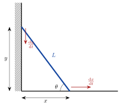

<!-- video: kommer (videoer/kalkulus/04-01-relaterte-rater) -->
{fig-alt="Video kommer"}

<!-- tillegg: Claude -->
En stige sklir ned langs en vegg. Foten glir utover med jevn fart, men toppen faller fortere og fortere. Når flere størrelser henger sammen gjennom en likning og alle endrer seg med tiden, henger også endringsratene sammen. Vi finner sammenhengen ved å derivere likningen med hensyn på tiden.

## Metoden

Alle størrelsene er funksjoner av tiden $t$, så når vi deriverer, gir [kjerneregelen](../03-derivasjon/04-kjerneregelen.qmd) en faktor $\dfrac{\mathrm{d}}{\mathrm{d}t}$ på hver av dem. Det er det samme som [implisitt derivasjon](../03-derivasjon/06-implisitt-derivasjon.qmd), bare med $t$ som variabel.

::: {.steg}
1. **Tegn en figur** og gi navn til størrelsene som endrer seg. Skriv opp det som er gitt og det som er spurt om, som deriverte med hensyn på $t$.
2. **Finn en likning** som binder størrelsene sammen (Pytagoras, formlikhet, en volumformel).
3. **Deriver** likningen med hensyn på $t$.
4. **Sett inn** tallene for øyeblikket du spør om, og løs ut den ukjente raten. Sett inn tallene *etter* at du har derivert, ellers forsvinner det som endrer seg.
:::

::: {.eksempel}
**Eksempel: Stigen.** En $5.0\ \mathrm{m}$ lang stige står mot en vegg. Foten glir bort fra veggen med $0.40\ \mathrm{m/s}$. Hvor fort sklir toppen nedover når foten er $3.0\ \mathrm{m}$ fra veggen?

::: {.losning}
{.tikz-fig fig-alt="En stige som står skrått mot en vegg. Avstanden fra veggen til foten er x og høyden til toppen er y. Piler viser at foten glir utover og toppen glir nedover."}

Gitt: $\dfrac{\mathrm{d}x}{\mathrm{d}t} = 0.40\ \mathrm{m/s}$. Spurt: $\dfrac{\mathrm{d}y}{\mathrm{d}t}$ når $x = 3.0\ \mathrm{m}$.

Likning (Pytagoras): $x^2 + y^2 = 5.0^2$. Deriver med hensyn på $t$:
$$
2x\,\frac{\mathrm{d}x}{\mathrm{d}t} + 2y\,\frac{\mathrm{d}y}{\mathrm{d}t} = 0 \quad\Longrightarrow\quad \frac{\mathrm{d}y}{\mathrm{d}t} = -\frac{x}{y}\,\frac{\mathrm{d}x}{\mathrm{d}t} .
$$
Når $x = 3.0$, er $y = \sqrt{25 - 9} = 4.0$, og
$$
\frac{\mathrm{d}y}{\mathrm{d}t} = -\frac{3.0}{4.0}\cdot 0.40\ \mathrm{m/s} = \underline{\underline{-0.30\ \mathrm{m/s}}} .
$$
Toppen sklir nedover med $0.30\ \mathrm{m/s}$. Legg merke til at $\dfrac{x}{y}$ vokser mot uendelig når $y \to 0$: Modellen sier at toppen treffer bakken med uendelig fart. I virkeligheten slipper stigen veggen før det.
:::
:::

::: {.eksempel}
**Eksempel: Kjegleformet tank.** En tank har form som en kjegle med spissen ned. Toppen har radius $2.0\ \mathrm{m}$ og høyden er $6.0\ \mathrm{m}$. Det pumpes inn vann med $0.50\ \mathrm{m^3/min}$. Hvor fort stiger vannflaten når vannet står $3.0\ \mathrm{m}$ høyt?

::: {.losning}
Vannet danner en mindre kjegle med høyde $h$ og radius $r$. Formlikhet med hele kjeglen gir $\dfrac{r}{h} = \dfrac{2.0}{6.0}$, så $r = \dfrac{h}{3}$. Volumet er
$$
V = \frac13\pi r^2 h = \frac13\pi\frac{h^2}{9}h = \frac{\pi}{27}h^3 .
$$
Deriver med hensyn på $t$:
$$
\frac{\mathrm{d}V}{\mathrm{d}t} = \frac{\pi}{9}h^2\frac{\mathrm{d}h}{\mathrm{d}t} \quad\Longrightarrow\quad \frac{\mathrm{d}h}{\mathrm{d}t} = \frac{9}{\pi h^2}\,\frac{\mathrm{d}V}{\mathrm{d}t} = \frac{9}{\pi\cdot 3.0^2}\cdot 0.50\ \mathrm{m/min} = \underline{\underline{0.16\ \mathrm{m/min}}} .
$$
Formlikheten var avgjørende: Den lot oss uttrykke volumet med én variabel før vi deriverte.
:::
:::

::: {.eksempel}
**Eksempel: To biler.** Bil A kjører nordover fra et kryss med $60\ \mathrm{km/h}$, bil B kjører østover fra det samme krysset med $80\ \mathrm{km/h}$. Begge passerte krysset kl. 12.00. Hvor fort øker avstanden mellom dem kl. 12.30?

::: {.losning}
Med $y$ og $x$ som avstandene fra krysset er avstanden $s = \sqrt{x^2 + y^2}$, eller $s^2 = x^2 + y^2$. Derivasjon:
$$
2s\,\frac{\mathrm{d}s}{\mathrm{d}t} = 2x\,\frac{\mathrm{d}x}{\mathrm{d}t} + 2y\,\frac{\mathrm{d}y}{\mathrm{d}t} .
$$
Kl. 12.30 er $x = 40\ \mathrm{km}$, $y = 30\ \mathrm{km}$ og $s = 50\ \mathrm{km}$:
$$
\frac{\mathrm{d}s}{\mathrm{d}t} = \frac{40\cdot 80 + 30\cdot 60}{50}\ \mathrm{km/h} = \underline{\underline{100\ \mathrm{km/h}}} .
$$
Fordi begge startet samtidig fra samme sted, øker avstanden med $100\ \mathrm{km/h}$ hele tiden ($\sqrt{60^2 + 80^2} = 100$).
:::
:::

## Prøv selv

Programmet simulerer stigen: Det regner ut toppens høyde for mange tidspunkter og deriverer numerisk. Sammenlign med formelen $\dfrac{\mathrm{d}y}{\mathrm{d}t} = -\dfrac{x}{y}\dfrac{\mathrm{d}x}{\mathrm{d}t}$.

```{.python .kjor}
import numpy as np

L, v = 5.0, 0.40                    # stigelengde (m), fart til foten (m/s)
t = np.linspace(0, 7.5, 7501)       # foten starter inntil veggen
x = v * t
y = np.sqrt(L**2 - x**2)
dydt = np.gradient(y, t)            # numerisk derivert

i = np.argmin(np.abs(x - 3.0))
print(f"x = {x[i]:.2f} m:  numerisk dy/dt = {dydt[i]:.4f} m/s,  formel = {-x[i]/y[i]*v:.4f} m/s")
```

:::: {.oppgaver}

::: {.oppgave tittel="Sirkulær bølge"}
En stein faller i vannet, og radien til bølgeringen vokser med $0.80\ \mathrm{m/s}$. Hvor fort vokser arealet inni ringen når radien er $5.0\ \mathrm{m}$?

::: {.losning}
$A = \pi r^2$, så $\dfrac{\mathrm{d}A}{\mathrm{d}t} = 2\pi r\,\dfrac{\mathrm{d}r}{\mathrm{d}t} = 2\pi\cdot 5.0\cdot 0.80\ \mathrm{m^2/s} = \underline{\underline{25\ \mathrm{m^2/s}}}$.
:::
:::

::: {.oppgave tittel="Skyggen" niva="Middels"}
En person som er $1.8\ \mathrm{m}$ høy, går bort fra en lyktestolpe som er $6.0\ \mathrm{m}$ høy, med $1.5\ \mathrm{m/s}$. Hvor fort blir skyggen lengre? Hvor fort beveger skyggens spiss seg?

::: {.losning}
La $x$ være avstanden fra stolpen til personen og $s$ skyggelengden. Formlikhet: $\dfrac{s}{1.8} = \dfrac{x + s}{6.0}$, som gir $6.0\,s = 1.8\,x + 1.8\,s$, så $s = \dfrac{1.8}{4.2}x = \dfrac37 x$. Da er
$$
\frac{\mathrm{d}s}{\mathrm{d}t} = \frac37\cdot 1.5\ \mathrm{m/s} = \underline{\underline{0.64\ \mathrm{m/s}}} .
$$
Spissen er i avstanden $x + s$ fra stolpen og beveger seg med $1.5 + 0.64 = \underline{\underline{2.1\ \mathrm{m/s}}}$. Begge svarene er uavhengige av hvor langt unna personen er.
:::
:::

::: {.oppgave tittel="Ideell gass" niva="Middels"}
En gass komprimeres langsomt ved konstant temperatur, slik at $pV = k$. Når $V = 2.0\ \mathrm{L}$ og $p = 150\ \mathrm{kPa}$, minker volumet med $0.10\ \mathrm{L/s}$. Hvor fort øker trykket?

::: {.losning}
$\dfrac{\mathrm{d}p}{\mathrm{d}t}V + p\dfrac{\mathrm{d}V}{\mathrm{d}t} = 0$, så
$$
\frac{\mathrm{d}p}{\mathrm{d}t} = -\frac{p}{V}\frac{\mathrm{d}V}{\mathrm{d}t} = -\frac{150}{2.0}\cdot(-0.10)\ \mathrm{kPa/s} = \underline{\underline{7.5\ \mathrm{kPa/s}}} .
$$
:::
:::

::: {.oppgave tittel="Radarvinkel" niva="Utfordrende"}
Et fly stiger rett opp fra et punkt $3.0\ \mathrm{km}$ fra en radar, med $0.20\ \mathrm{km/s}$. Hvor fort øker elevasjonsvinkelen $\theta$ når flyet er $4.0\ \mathrm{km}$ over bakken?

::: {.losning}
$\tan\theta = \dfrac{h}{3.0}$. Derivasjon: $\dfrac{1}{\cos^2\theta}\dfrac{\mathrm{d}\theta}{\mathrm{d}t} = \dfrac{1}{3.0}\dfrac{\mathrm{d}h}{\mathrm{d}t}$. Når $h = 4.0$, er avstanden til flyet $5.0\ \mathrm{km}$ og $\cos\theta = \dfrac{3.0}{5.0}$. Da er
$$
\frac{\mathrm{d}\theta}{\mathrm{d}t} = \cos^2\theta\cdot\frac{0.20}{3.0}\ \mathrm{rad/s} = 0.36\cdot 0.0667\ \mathrm{rad/s} = \underline{\underline{0.024\ \mathrm{rad/s}}} .
$$
:::
:::

::::
