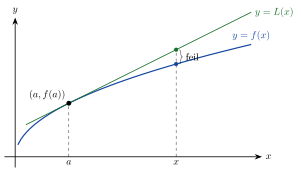

<!-- video: kommer (videoer/kalkulus/04-02-linearisering) -->
{fig-alt="Video kommer"}

<!-- tillegg: Claude -->
Zoomer du inn på grafen til en deriverbar funksjon, ser den mer og mer ut som en rett linje. Den linja er tangenten. Nær et punkt kan vi derfor erstatte en vanskelig funksjon med tangentlinja og regne med den i stedet. Det er grunnen til at fysikere skriver $\sin\theta \approx \theta$ for små vinkler, og at ingeniører kan regne ut hvor stor feil en måleusikkerhet gir.

## Lineær tilnærming

::: {.callout-important title="Linearisering"}
Lineariseringen av $f$ i punktet $a$ er tangentlinja
$$
L(x) = f(a) + f'(a)(x - a),
$$
og for $x$ nær $a$ er
$$
f(x) \approx f(a) + f'(a)(x - a) .
$$
:::

{.tikz-fig fig-alt="Grafen til kvadratroten og tangentlinja i punktet a. Ved en x lenger til høyre er avstanden mellom tangenten og grafen markert som feil."}

Hvor god er tilnærmingen? Feilen er liten når $x$ er nær $a$, og den blir mindre jo mindre krum grafen er. Mer presist er feilen omtrent $\tfrac12 f''(a)(x - a)^2$. Halverer vi avstanden til $a$, blir feilen omtrent fire ganger mindre. Det kommer vi tilbake til med [Taylorpolynomer](../09-taylor/01-taylorpolynomer.qmd).

::: {.eksempel}
**Eksempel: Kvadratrot i hodet.** Bruk linearisering av $\sqrt{x}$ i $a = 25$ til å anslå $\sqrt{26}$ og $\sqrt{24.5}$.

::: {.losning}
$f(x) = \sqrt{x}$, $f'(x) = \dfrac{1}{2\sqrt{x}}$, så $f(25) = 5$ og $f'(25) = \tfrac{1}{10}$. Da er $L(x) = 5 + 0.1(x - 25)$, og
$$
\sqrt{26} \approx 5 + 0.1 = 5.1, \qquad \sqrt{24.5} \approx 5 - 0.05 = 4.95 .
$$
Eksakt er $\sqrt{26} = 5.0990$ og $\sqrt{24.5} = 4.9497$. Feilene er $0.0010$ og $0.0003$: fire ganger mindre feil for halvparten så stort steg.
:::
:::

## Standardtilnærmingene

For $x$ nær $0$ gir lineariseringen noen tilnærminger som brukes hele tiden:

::: {.kort}
- **$\sin x \approx x$** Vinkel i radianer. Grunnlaget for den matematiske pendelen.
- **$\tan x \approx x$** Små helningsvinkler: stigningen er omtrent lik vinkelen.
- **$\cos x \approx 1$** Lineariseringen er konstant. (Neste ledd, $1 - \tfrac{x^2}{2}$, er ofte nødvendig.)
- **$\mathrm{e}^x \approx 1 + x$** Små vekstrater: $\mathrm{e}^{0.03} \approx 1.03$.
- **$\ln(1 + x) \approx x$** Små relative endringer.
- **$(1 + x)^r \approx 1 + rx$** For eksempel $\sqrt{1 + x} \approx 1 + \tfrac{x}{2}$ og $\dfrac{1}{1 + x} \approx 1 - x$.
:::

::: {.eksempel}
**Eksempel: Relativistisk energi.** Den kinetiske energien til et legeme med fart $v$ er $E_\text{k} = mc^2\left(\dfrac{1}{\sqrt{1 - v^2/c^2}} - 1\right)$. Vis at dette er omtrent $\tfrac12 mv^2$ når $v$ er liten sammenlignet med lysfarten $c$.

::: {.losning}
Med $u = \dfrac{v^2}{c^2}$, som er liten, gir $(1 + x)^r \approx 1 + rx$ med $x = -u$ og $r = -\tfrac12$:
$$
\frac{1}{\sqrt{1 - u}} = (1 - u)^{-1/2} \approx 1 + \frac12 u .
$$
Da er
$$
E_\text{k} \approx mc^2\cdot\frac12\cdot\frac{v^2}{c^2} = \frac12 mv^2 .
$$
Newtons uttrykk for kinetisk energi er lineariseringen av det relativistiske.
:::
:::

## Differensialer og feilforplantning

Skriver vi $\Delta x = x - a$ for en liten endring i $x$, sier lineariseringen at endringen i $y = f(x)$ er omtrent
$$
\Delta y \approx f'(a)\,\Delta x .
$$
Vi kaller $\mathrm{d}x$ og $\mathrm{d}y = f'(x)\,\mathrm{d}x$ **differensialer**. Med denne skrivemåten blir $\dfrac{\mathrm{d}y}{\mathrm{d}x}$ en brøk av to (små) tall. Differensialet $\mathrm{d}y$ er endringen langs tangenten, mens $\Delta y$ er endringen langs grafen.

Den viktigste anvendelsen er **feilforplantning**: Er en målt størrelse usikker med $\Delta x$, er en størrelse beregnet fra den usikker med omtrent $|f'(x)|\,\Delta x$.

::: {.eksempel}
**Eksempel: Volum av en kule.** Diameteren til en stålkule måles til $d = 20.0\ \mathrm{mm}$ med en usikkerhet på $\pm 0.1\ \mathrm{mm}$. Hvor stor er usikkerheten i volumet, absolutt og relativt?

::: {.losning}
$V = \dfrac{\pi}{6}d^3$, så $\mathrm{d}V = \dfrac{\pi}{2}d^2\,\mathrm{d}d$. Med $d = 20.0\ \mathrm{mm}$ og $\mathrm{d}d = 0.1\ \mathrm{mm}$:
$$
V = \frac{\pi}{6}\cdot 20.0^3\ \mathrm{mm^3} = 4189\ \mathrm{mm^3}, \qquad \Delta V \approx \frac{\pi}{2}\cdot 20.0^2\cdot 0.1\ \mathrm{mm^3} = 63\ \mathrm{mm^3} .
$$
Relativt:
$$
\frac{\Delta V}{V} \approx 3\,\frac{\Delta d}{d} = 3\cdot\frac{0.1}{20.0} = \underline{\underline{1.5\ \%}} .
$$
Den relative usikkerheten tredobles, fordi volumet går som $d^3$. Generelt gir $y = x^n$ at $\dfrac{\Delta y}{y} \approx n\,\dfrac{\Delta x}{x}$.
:::
:::

## Prøv selv

Programmet sammenligner $\sin x$ med lineariseringen $x$, og viser hvor stor den relative feilen er for vinkler opp til $30^\circ$. Hvor stor vinkel kan en pendel ha før feilen i $\sin\theta \approx \theta$ er over $1\ \%$?

```{.python .kjor}
import numpy as np

for grader in [2, 5, 10, 15, 20, 25, 30]:
    x = np.radians(grader)
    print(f"{grader:3d}°:  sin x = {np.sin(x):.5f},  x = {x:.5f},  relativ feil {100*(x - np.sin(x))/np.sin(x):.2f} %")
```

:::: {.oppgaver}

::: {.oppgave tittel="Linearisering"}
Finn lineariseringen av $f(x) = \ln x$ i $a = 1$, og bruk den til å anslå $\ln 1.04$ og $\ln 0.97$.

::: {.losning}
$f(1) = 0$, $f'(1) = 1$, så $L(x) = x - 1$. Da er $\ln 1.04 \approx 0.04$ og $\ln 0.97 \approx -0.03$. (Eksakt: $0.0392$ og $-0.0305$.)
:::
:::

::: {.oppgave tittel="Tredjerot"}
Anslå $\sqrt[3]{8.24}$ med en linearisering.

::: {.losning}
$f(x) = x^{1/3}$, $f'(x) = \dfrac{1}{3x^{2/3}}$, $f(8) = 2$, $f'(8) = \dfrac{1}{12}$. Da er $\sqrt[3]{8.24} \approx 2 + \dfrac{0.24}{12} = \underline{\underline{2.02}}$. (Eksakt: $2.0198$.)
:::
:::

::: {.oppgave tittel="Pendelklokke" niva="Middels"}
Svingetiden til en pendel er $T = 2\pi\sqrt{L/\mathrm{g}}$. Lengden øker med $0.10\ \%$ på grunn av varme. Hvor mange prosent øker svingetiden, og hvor mange sekunder taper klokka i døgnet?

::: {.losning}
$T$ går som $L^{1/2}$, så $\dfrac{\Delta T}{T} \approx \dfrac12\cdot\dfrac{\Delta L}{L} = 0.050\ \%$. Klokka går $0.050\ \%$ for sakte og taper
$$
0.00050\cdot 86400\ \mathrm{s} = \underline{\underline{43\ \mathrm{s}}}
$$
i døgnet.
:::
:::

::: {.oppgave tittel="Høyde fra vinkel" niva="Utfordrende"}
Du står $50.0\ \mathrm{m}$ fra et tårn og måler vinkelen opp til toppen til $35.0^\circ$, med en usikkerhet på $\pm 0.5^\circ$. Finn høyden og usikkerheten i høyden. Hvilken vinkel gir minst relativ usikkerhet?

::: {.losning}
$h = 50.0\tan\theta = 50.0\tan 35.0^\circ\ \mathrm{m} = 35.0\ \mathrm{m}$. $\mathrm{d}h = \dfrac{50.0}{\cos^2\theta}\,\mathrm{d}\theta$, med $\mathrm{d}\theta = 0.5^\circ = 0.00873\ \mathrm{rad}$:
$$
\Delta h \approx \frac{50.0}{\cos^2 35.0^\circ}\cdot 0.00873\ \mathrm{m} = \frac{50.0}{0.671}\cdot 0.00873\ \mathrm{m} = \underline{\underline{0.65\ \mathrm{m}}} .
$$
Relativ usikkerhet: $\dfrac{\Delta h}{h} = \dfrac{\mathrm{d}\theta}{\sin\theta\cos\theta} = \dfrac{2\,\mathrm{d}\theta}{\sin 2\theta}$. Den er minst når $\sin 2\theta = 1$, altså ved $\theta = 45^\circ$. Da bør du stå like langt fra tårnet som det er høyt.
:::
:::

::::
