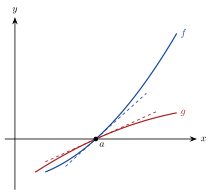

<!-- video: kommer (videoer/kalkulus/04-03-lhopital) -->
{fig-alt="Video kommer"}

<!-- tillegg: Claude -->
Grenser som $\displaystyle\lim_{x\to 0}\frac{\mathrm{e}^x - 1 - x}{x^2}$ gir $\tfrac00$ når vi setter inn, og ingen faktorisering hjelper. Teller og nevner går begge mot null, og spørsmålet er hvem som går fortest. Det avgjøres av de deriverte. L'Hôpitals regel gjør idéen til en enkel oppskrift.

## Idéen

Er $f(a) = g(a) = 0$, gir [lineariseringen](02-linearisering.qmd) nær $a$
$$
\frac{f(x)}{g(x)} \approx \frac{f'(a)(x - a)}{g'(a)(x - a)} = \frac{f'(a)}{g'(a)} .
$$
Nær $a$ oppfører begge funksjonene seg som rette linjer gjennom $(a, 0)$, og forholdet mellom dem er forholdet mellom stigningstallene.

{.tikz-fig fig-alt="To kurver f og g som begge krysser x-aksen i punktet a, med stiplede tangenter. Tangenten til f er brattere enn tangenten til g."}

::: {.callout-important title="L'Hôpitals regel"}
La $f$ og $g$ være deriverbare nær $a$ (unntatt kanskje i $a$), med $g'(x) \neq 0$ der. Hvis
$$
\lim_{x\to a} f(x) = \lim_{x\to a} g(x) = 0 \quad\text{eller}\quad \lim_{x\to a} f(x) = \pm\infty \ \text{og}\ \lim_{x\to a} g(x) = \pm\infty,
$$
så er
$$
\lim_{x\to a}\frac{f(x)}{g(x)} = \lim_{x\to a}\frac{f'(x)}{g'(x)},
$$
forutsatt at grensen til høyre finnes (eller er $\pm\infty$). Regelen gjelder også når $a = \pm\infty$, og for ensidige grenser.
:::

Merk at vi deriverer teller og nevner **hver for seg**. Det er ikke kvotientregelen.

::: {.eksempel}
**Eksempel: Typen 0/0.** Finn a) $\displaystyle\lim_{x\to 0}\frac{\mathrm{e}^x - 1 - x}{x^2}$ b) $\displaystyle\lim_{x\to 1}\frac{\ln x}{x^3 - 1}$

::: {.losning}
a) Typen $\tfrac00$. Én gang L'Hôpital gir $\dfrac{\mathrm{e}^x - 1}{2x}$, som fortsatt er $\tfrac00$. En gang til:
$$
\lim_{x\to 0}\frac{\mathrm{e}^x - 1 - x}{x^2} = \lim_{x\to 0}\frac{\mathrm{e}^x - 1}{2x} = \lim_{x\to 0}\frac{\mathrm{e}^x}{2} = \underline{\underline{\frac12}} .
$$

b) Typen $\tfrac00$:
$$
\lim_{x\to 1}\frac{1/x}{3x^2} = \frac{1}{3} .
$$
:::
:::

## Hvem vokser fortest?

Med typen $\tfrac{\infty}{\infty}$ kan vi bevise rangeringen fra [asymptotesiden](../02-grenseverdier/04-asymptoter.qmd): logaritmer taper mot potenser, og potenser taper mot eksponentialfunksjoner.

::: {.eksempel}
**Eksempel: Eksponentialfunksjonen slår alle potenser.** Vis at $\displaystyle\lim_{x\to\infty}\frac{x^3}{\mathrm{e}^x} = 0$ og $\displaystyle\lim_{x\to\infty}\frac{\ln x}{\sqrt{x}} = 0$.

::: {.losning}
Tre ganger L'Hôpital (typen $\tfrac{\infty}{\infty}$ hver gang):
$$
\lim_{x\to\infty}\frac{x^3}{\mathrm{e}^x} = \lim_{x\to\infty}\frac{3x^2}{\mathrm{e}^x} = \lim_{x\to\infty}\frac{6x}{\mathrm{e}^x} = \lim_{x\to\infty}\frac{6}{\mathrm{e}^x} = 0 .
$$
For logaritmen:
$$
\lim_{x\to\infty}\frac{\ln x}{x^{1/2}} = \lim_{x\to\infty}\frac{1/x}{\tfrac12 x^{-1/2}} = \lim_{x\to\infty}\frac{2}{\sqrt{x}} = 0 .
$$
:::
:::

## Andre ubestemte uttrykk

Regelen gjelder bare brøker av typen $\tfrac00$ og $\tfrac{\infty}{\infty}$. Andre ubestemte former skriver vi om først:

::: {.kort}
- **$0\cdot\infty$** Skriv $f\cdot g = \dfrac{f}{1/g}$ eller $\dfrac{g}{1/f}$.
- **$\infty - \infty$** Sett på felles brøkstrek eller trekk ut en faktor.
- **$1^\infty$, $0^0$, $\infty^0$** Ta logaritmen: $y = f^g$ gir $\ln y = g\ln f$, som er av typen $0\cdot\infty$. Til slutt er grensen $\mathrm{e}^{\lim\ln y}$.
:::

::: {.eksempel}
**Eksempel: Rentes rente uendelig ofte.** Finn $\displaystyle\lim_{n\to\infty}\left(1 + \frac{r}{n}\right)^{n}$.

::: {.losning}
Typen $1^\infty$. Sett $y = \left(1 + \tfrac{r}{n}\right)^n$, og la $n$ være en kontinuerlig variabel. Da er
$$
\ln y = n\ln\!\left(1 + \frac{r}{n}\right) = \frac{\ln(1 + r/n)}{1/n},
$$
som er av typen $\tfrac00$. Med $u = \tfrac1n \to 0^+$:
$$
\lim_{u\to 0^+}\frac{\ln(1 + ru)}{u} = \lim_{u\to 0^+}\frac{r/(1 + ru)}{1} = r .
$$
Altså er $\ln y \to r$, og $\displaystyle\lim_{n\to\infty}\left(1 + \frac{r}{n}\right)^n = \mathrm{e}^r$. Det er kontinuerlig forrentning, og med $r = 1$ en definisjon av tallet $\mathrm{e}$.
:::
:::

::: {.eksempel}
**Eksempel: x ln x.** Finn $\displaystyle\lim_{x\to 0^+}x\ln x$ og $\displaystyle\lim_{x\to 0^+}x^x$.

::: {.losning}
Typen $0\cdot(-\infty)$. Skriv som brøk:
$$
\lim_{x\to 0^+}\frac{\ln x}{1/x} = \lim_{x\to 0^+}\frac{1/x}{-1/x^2} = \lim_{x\to 0^+}(-x) = 0 .
$$
For $x^x = \mathrm{e}^{x\ln x}$ følger det at $\displaystyle\lim_{x\to 0^+}x^x = \mathrm{e}^0 = 1$.
:::
:::

## Fallgruver

::: {.callout-warning title="Sjekk typen først"}
Bruk regelen bare når uttrykket faktisk er $\tfrac00$ eller $\tfrac{\infty}{\infty}$. For eksempel er $\displaystyle\lim_{x\to 0}\frac{x + 1}{x + 2} = \frac12$ ved innsetting, mens L'Hôpital feilaktig ville gitt $\dfrac11 = 1$.
:::

Regelen sier heller ingenting hvis $\lim\dfrac{f'}{g'}$ ikke finnes. $\dfrac{x + \sin x}{x} \to 1$ når $x \to \infty$ (del på $x$), men $\dfrac{1 + \cos x}{1}$ svinger og har ingen grense. Da må vi finne grensen på annen måte.

## Prøv selv

```{.python .kjor}
import numpy as np

f = lambda x: (np.exp(x) - 1 - x) / x**2
for x in [0.1, 0.01, 0.001, 1e-5, 1e-8]:
    print(f"x = {x:7.0e}:  {f(x):.10f}")
# Ved svært små x blir svaret ubrukelig: telleren er differansen mellom nesten like tall.
# L'Hôpital (eller Taylor) gir det eksakte svaret 0.5.
```

:::: {.oppgaver}

::: {.oppgave tittel="0/0 og ∞/∞"}
a) $\displaystyle\lim_{x\to 0}\frac{\sin 3x}{\tan 5x}$ b) $\displaystyle\lim_{x\to 0}\frac{1 - \cos x}{x^2}$ c) $\displaystyle\lim_{x\to\infty}\frac{x^2 + \ln x}{2x^2 + 3}$

::: {.losning}
a) $\dfrac{3\cos 3x}{5/\cos^2 5x} \to \underline{\underline{\dfrac35}}$

b) $\dfrac{\sin x}{2x} \to \dfrac12$ (eller L'Hôpital en gang til: $\dfrac{\cos x}{2} \to \dfrac12$). Svar: $\underline{\underline{\tfrac12}}$

c) $\dfrac{2x + 1/x}{4x} = \dfrac12 + \dfrac{1}{4x^2} \to \underline{\underline{\dfrac12}}$
:::
:::

::: {.oppgave tittel="∞ − ∞"}
Finn $\displaystyle\lim_{x\to 0}\left(\frac{1}{x} - \frac{1}{\sin x}\right)$.

::: {.losning}
Felles brøkstrek: $\dfrac{\sin x - x}{x\sin x}$, typen $\tfrac00$. L'Hôpital: $\dfrac{\cos x - 1}{\sin x + x\cos x}$, fortsatt $\tfrac00$. En gang til: $\dfrac{-\sin x}{2\cos x - x\sin x} \to \dfrac{0}{2} = \underline{\underline{0}}$.
:::
:::

::: {.oppgave tittel="En potens" niva="Middels"}
Finn $\displaystyle\lim_{x\to\infty}x^{1/x}$ og $\displaystyle\lim_{x\to 0^+}(1 + 2x)^{1/x}$.

::: {.losning}
$\ln x^{1/x} = \dfrac{\ln x}{x} \to 0$ (L'Hôpital: $\dfrac{1/x}{1} \to 0$), så $x^{1/x} \to \mathrm{e}^0 = \underline{\underline{1}}$.

$\ln(1 + 2x)^{1/x} = \dfrac{\ln(1 + 2x)}{x} \to \dfrac{2/(1 + 2x)}{1} \to 2$, så grensen er $\underline{\underline{\mathrm{e}^2}}$.
:::
:::

::: {.oppgave tittel="Fritt fall med luftmotstand" niva="Utfordrende"}
Med luftmotstand proporsjonal med farten er farten til et fallende legeme
$$
v(t) = \frac{m\mathrm{g}}{k}\left(1 - \mathrm{e}^{-kt/m}\right) .
$$
Vis at $v(t) \to \mathrm{g}t$ når $k \to 0$, altså at vi får fritt fall uten luftmotstand.

::: {.losning}
For fast $t$ er dette en grense i $k$ av typen $\tfrac00$:
$$
\lim_{k\to 0}\frac{m\mathrm{g}\left(1 - \mathrm{e}^{-kt/m}\right)}{k} = \lim_{k\to 0}\frac{m\mathrm{g}\cdot\dfrac{t}{m}\mathrm{e}^{-kt/m}}{1} = \mathrm{g}t .
$$
Modellen med luftmotstand inneholder modellen uten som et grensetilfelle, slik den bør.
:::
:::

::::
