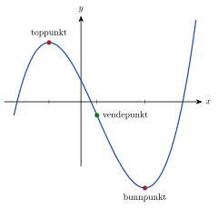

<!-- video: kommer (videoer/kalkulus/04-04-drofting) -->
{fig-alt="Video kommer"}

<!-- tillegg: Claude -->
Et plott fra en datamaskin viser noen få hundre punkter. Det kan skjule en smal topp, en asymptote eller et vendepunkt. Den deriverte og den andrederiverte forteller *hvorfor* grafen ser ut som den gjør, og hvor de viktige punktene er. Å drøfte en funksjon betyr å finne disse punktene og sette sammen bildet.

## Monotoni og ekstremalpunkter

Fra [middelverdisetningen](../03-derivasjon/08-middelverdisetningen.qmd) vet vi at $f$ er voksende der $f' > 0$ og avtakende der $f' < 0$.

::: {.callout-note title="Definisjon: Kritisk punkt"}
Et **kritisk punkt** for $f$ er et punkt $c$ i definisjonsmengden der $f'(c) = 0$ eller $f'(c)$ ikke finnes.
:::

::: {.callout-important title="Ekstremalpunkter"}
Har $f$ et lokalt toppunkt eller bunnpunkt i et indre punkt $c$, er $c$ et kritisk punkt.

**Førstederiverttesten:** Skifter $f'$ fortegn fra $+$ til $-$ i $c$, er $c$ et lokalt toppunkt. Fra $-$ til $+$ er det et lokalt bunnpunkt. Skifter den ikke fortegn, er det ingen ekstremalpunkt.

**Andrederiverttesten:** Er $f'(c) = 0$ og $f''(c) < 0$, er $c$ et lokalt toppunkt. Er $f''(c) > 0$, er det et lokalt bunnpunkt. Er $f''(c) = 0$, sier testen ingenting.
:::

Ikke alle kritiske punkter er ekstremalpunkter: $f(x) = x^3$ har $f'(0) = 0$, men er voksende hele veien.

## Krumning og vendepunkter

Der $f'' > 0$, er $f'$ voksende: tangentene blir brattere, og grafen **krummer oppover** (konveks, som en skål). Der $f'' < 0$, **krummer grafen nedover** (konkav). Et **vendepunkt** er et punkt der krumningen skifter, altså der $f''$ skifter fortegn.

{.tikz-fig fig-alt="En tredjegradskurve som stiger til et toppunkt i x = -1, faller gjennom et vendepunkt i x = 0.5 og når et bunnpunkt i x = 2 før den stiger igjen."}

::: {.eksempel}
**Eksempel: Et tredjegradspolynom.** Drøft $f(x) = x^3 - 1.5x^2 - 6x + 2$.

::: {.losning}
$$
f'(x) = 3x^2 - 3x - 6 = 3(x + 1)(x - 2), \qquad f''(x) = 6x - 3 .
$$
*Monotoni:* $f' > 0$ for $x < -1$ og $x > 2$, $f' < 0$ for $-1 < x < 2$. Funksjonen er voksende, så avtakende, så voksende.

*Ekstremalpunkter:* Toppunkt i $(-1, f(-1)) = (-1, 5.5)$ og bunnpunkt i $(2, f(2)) = (2, -8)$. Andrederiverttesten bekrefter: $f''(-1) = -9 < 0$ og $f''(2) = 9 > 0$.

*Krumning:* $f'' < 0$ for $x < 0.5$ og $f'' > 0$ for $x > 0.5$. Vendepunkt i $(0.5, -1.25)$.

Vendepunktet ligger midt mellom ekstremalpunktene. Det gjelder alle tredjegradspolynomer med to ekstremalpunkter.
:::
:::

## Full drøfting

::: {.steg}
1. **Definisjonsmengde**, nullpunkter og eventuell symmetri.
2. **Asymptoter**: vertikale (nevneren null) og vannrette eller skrå (oppførsel når $x \to \pm\infty$).
3. **Førstederivert**: fortegnslinje, monotoni og ekstremalpunkter.
4. **Andrederivert**: fortegnslinje, krumning og vendepunkter.
5. **Skisse**: sett sammen alt, og kontroller mot et plott.
:::

::: {.eksempel}
**Eksempel: En funksjon med eksponentialfaktor.** Drøft $f(x) = x\,\mathrm{e}^{-x}$.

::: {.losning}
*Definisjonsmengde og nullpunkt:* alle $x$, nullpunkt i $x = 0$. $f(x) > 0$ for $x > 0$.

*Asymptoter:* $\displaystyle\lim_{x\to\infty}\frac{x}{\mathrm{e}^x} = 0$ ([L'Hôpital](03-lhopital.qmd)), så $y = 0$ er en vannrett asymptote til høyre. Når $x \to -\infty$, går $f(x) \to -\infty$.

*Førstederivert:* $f'(x) = \mathrm{e}^{-x} - x\,\mathrm{e}^{-x} = (1 - x)\,\mathrm{e}^{-x}$. Positiv for $x < 1$, negativ for $x > 1$. Toppunkt i $\left(1, \mathrm{e}^{-1}\right) \approx (1, 0.368)$.

*Andrederivert:* $f''(x) = -\mathrm{e}^{-x} - (1 - x)\,\mathrm{e}^{-x} = (x - 2)\,\mathrm{e}^{-x}$. Negativ for $x < 2$, positiv for $x > 2$. Vendepunkt i $\left(2, 2\mathrm{e}^{-2}\right) \approx (2, 0.271)$.

Grafen stiger fra $-\infty$, krummer nedover, har toppunkt i $x = 1$, vender i $x = 2$ og legger seg inn mot $x$-aksen ovenfra. Slike funksjoner beskriver f.eks. konsentrasjonen av et legemiddel som tas opp og brytes ned.
:::
:::

## Prøv selv

Programmet plotter $f$, $f'$ og $f''$ i samme figur. Se hvordan nullpunktene til $f'$ og $f''$ svarer til topp-, bunn- og vendepunktene til $f$. Bytt ut funksjonen.

```{.python .kjor}
import numpy as np
import matplotlib.pyplot as plt

x = np.linspace(-1, 6, 600)
f   = x * np.exp(-x)
df  = (1 - x) * np.exp(-x)
d2f = (x - 2) * np.exp(-x)

plt.plot(x, f, label="f"); plt.plot(x, df, "--", label="f'"); plt.plot(x, d2f, ":", label="f''")
plt.axhline(0, color="k", lw=0.8); plt.ylim(-1.5, 1.5); plt.grid(alpha=0.3); plt.legend()
plt.show()
```

:::: {.oppgaver}

::: {.oppgave tittel="Ekstremalpunkter"}
Finn topp- og bunnpunktene til $f(x) = x^4 - 8x^2 + 3$, og avgjør hvor grafen krummer oppover.

::: {.losning}
$f'(x) = 4x^3 - 16x = 4x(x - 2)(x + 2)$. Fortegnslinja gir bunnpunkter i $(\pm 2, -13)$ og toppunkt i $(0, 3)$.

$f''(x) = 12x^2 - 16 > 0$ for $|x| > \dfrac{2}{\sqrt3} \approx 1.15$. Grafen krummer oppover for $|x| > 1.15$ og nedover for $|x| < 1.15$, med vendepunkter i $x = \pm 1.15$.
:::
:::

::: {.oppgave tittel="En rasjonal funksjon" niva="Middels"}
Drøft $f(x) = \dfrac{x^2}{x^2 - 4}$: asymptoter, monotoni, ekstremalpunkter og krumning.

::: {.losning}
Definert for $x \neq \pm 2$, like funksjon. Vertikale asymptoter $x = \pm 2$, vannrett asymptote $y = 1$.

$f'(x) = \dfrac{2x(x^2 - 4) - x^2\cdot 2x}{(x^2 - 4)^2} = \dfrac{-8x}{(x^2 - 4)^2}$. Voksende for $x < 0$ (unntatt i $-2$), avtakende for $x > 0$. Lokalt toppunkt i $(0, 0)$.

$f''(x) = \dfrac{24x^2 + 32}{(x^2 - 4)^3}$. Telleren er alltid positiv, så fortegnet er fortegnet til $(x^2 - 4)^3$: grafen krummer oppover for $|x| > 2$ og nedover for $|x| < 2$. Ingen vendepunkter (krumningen skifter bare ved asymptotene).
:::
:::

::: {.oppgave tittel="Logistisk vekst" niva="Middels"}
En populasjon følger $P(t) = \dfrac{1000}{1 + 9\,\mathrm{e}^{-0.5t}}$. Når vokser populasjonen raskest, og hvor stor er den da?

::: {.losning}
Veksten er raskest i vendepunktet. Skriv $P = \dfrac{K}{1 + A\mathrm{e}^{-rt}}$ med $K = 1000$, $A = 9$, $r = 0.5$. Det kan vises (deriver to ganger, eller bruk at $P' = rP(1 - P/K)$) at $P'' = 0$ når $P = \dfrac{K}{2}$, altså når $A\mathrm{e}^{-rt} = 1$:
$$
t = \frac{\ln 9}{0.5} = \underline{\underline{4.4}}, \qquad P = \underline{\underline{500}} .
$$
Populasjonen vokser raskest når den er halvparten av bæreevnen.
:::
:::

::: {.oppgave tittel="Vendepunkt uten krumningsskifte?" niva="Utfordrende"}
Vis at $f(x) = x^4$ har $f''(0) = 0$, men ikke vendepunkt i $0$. Hva sier andrederiverttesten om $x = 0$, og hvordan kan du avgjøre hva slags punkt det er?

::: {.losning}
$f''(x) = 12x^2$, så $f''(0) = 0$, men $f'' \geq 0$ på begge sider: ingen fortegnsskifte og ingen vendepunkt. Andrederiverttesten sier ingenting når $f''(0) = 0$. Førstederiverttesten avgjør: $f'(x) = 4x^3$ skifter fra $-$ til $+$, så $x = 0$ er et bunnpunkt.
:::
:::

::::
