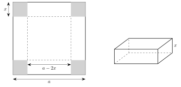

<!-- video: kommer (videoer/kalkulus/04-05-optimering) -->
{fig-alt="Video kommer"}

<!-- tillegg: Claude -->
Hvordan lager vi en boks med størst mulig volum av et ark? Hvilken form på en boks bruker minst materiale? Hvilken vei tar lyset? Optimering er å finne den største eller minste verdien av en størrelse som avhenger av noe vi kan velge. Med derivasjon blir slike spørsmål til en likning: $f'(x) = 0$.

## Største og minste verdi på et lukket intervall

Ifølge [ekstremalverdisetningen](../02-grenseverdier/03-kontinuitet.qmd) har en kontinuerlig funksjon på et lukket intervall $[a, b]$ både en største og en minste verdi. De kan ligge i et kritisk punkt eller i et endepunkt.

::: {.callout-important title="Største og minste verdi på [a, b]"}
1. Finn de kritiske punktene til $f$ i $(a, b)$.
2. Regn ut $f$ i de kritiske punktene og i endepunktene $a$ og $b$.
3. Den største av verdiene er maksimum, den minste er minimum.
:::

Fordelen med metoden: Vi trenger ikke avgjøre om hvert kritisk punkt er topp- eller bunnpunkt. Vi sammenligner bare tallene.

::: {.eksempel}
**Eksempel: På et intervall.** Finn største og minste verdi av $f(x) = 2x^3 - 3x^2 - 12x + 4$ på $[-2, 4]$.

::: {.losning}
$f'(x) = 6x^2 - 6x - 12 = 6(x - 2)(x + 1)$. Kritiske punkter: $x = -1$ og $x = 2$.
$$
f(-2) = 0, \quad f(-1) = 11, \quad f(2) = -16, \quad f(4) = 36 .
$$
Største verdi er $36$ (i endepunktet $x = 4$), minste er $-16$ (i $x = 2$).
:::
:::

## Optimeringsproblemer

::: {.steg}
1. **Tegn** og gi navn til størrelsene. Hva skal bli størst eller minst?
2. **Skriv** størrelsen som funksjon av én variabel. Bruk bibetingelsene til å eliminere de andre.
3. **Finn** definisjonsmengden, altså hvilke verdier som gir mening fysisk.
4. **Deriver**, finn de kritiske punktene, og avgjør hvilket som gir optimum (sammenlign med endepunktene, eller bruk fortegnet til $f'$).
5. **Svar** på spørsmålet med enhet, og sjekk at svaret er rimelig.
:::

::: {.eksempel}
**Eksempel: Boks av et ark.** Fra et kvadratisk ark med side $a = 30\ \mathrm{cm}$ klipper vi bort et kvadrat med side $x$ i hvert hjørne, og bretter opp kantene til en åpen boks. Hvilken $x$ gir størst volum?

::: {.losning}
{.tikz-fig fig-alt="Et kvadratisk ark med side a der fire små kvadrater med side x er markert i hjørnene, og bunnflaten har side a minus 2x. Ved siden av er den ferdige åpne boksen med høyde x."}

Volumet er $V(x) = x(30 - 2x)^2$ (i $\mathrm{cm^3}$), med $0 \leq x \leq 15$.
$$
V'(x) = (30 - 2x)^2 + x\cdot 2(30 - 2x)(-2) = (30 - 2x)(30 - 2x - 4x) = (30 - 2x)(30 - 6x) .
$$
Kritiske punkter: $x = 15$ (endepunkt, $V = 0$) og $x = 5$. Endepunktene gir $V(0) = V(15) = 0$, så maksimum er i $x = 5\ \mathrm{cm}$:
$$
V(5) = 5\cdot 20^2\ \mathrm{cm^3} = \underline{\underline{2000\ \mathrm{cm^3}}} = 2.0\ \mathrm{L} .
$$
Generelt er det beste valget $x = \dfrac{a}{6}$.
:::
:::

::: {.eksempel}
**Eksempel: Hermetikkboks.** En sylindrisk boks skal romme $V = 0.50\ \mathrm{L} = 500\ \mathrm{cm^3}$. Hvilken radius og høyde gir minst overflate (minst blikk)?

::: {.losning}
Overflaten er $A = 2\pi r^2 + 2\pi rh$ (bunn, lokk og sidevegg). Bibetingelsen $\pi r^2 h = V$ gir $h = \dfrac{V}{\pi r^2}$, så
$$
A(r) = 2\pi r^2 + \frac{2V}{r}, \qquad r > 0 .
$$
$$
A'(r) = 4\pi r - \frac{2V}{r^2} = 0 \quad\Longrightarrow\quad r^3 = \frac{V}{2\pi} \quad\Longrightarrow\quad r = \sqrt[3]{\frac{500}{2\pi}}\ \mathrm{cm} = 4.30\ \mathrm{cm} .
$$
$A'(r) < 0$ for mindre $r$ og $A'(r) > 0$ for større $r$, så dette er minimum. Høyden er
$$
h = \frac{V}{\pi r^2} = \frac{500}{\pi\cdot 4.30^2}\ \mathrm{cm} = 8.60\ \mathrm{cm} = 2r .
$$
Den beste boksen er like høy som den er bred. Ekte bokser er ofte høyere, fordi lokk og bunn er tykkere og dyrere enn sideveggen.
:::
:::

::: {.eksempel}
**Eksempel: Lysbrytning.** Lyset går fra punktet $A$ i luft til punktet $B$ i vann. I luft er farten $v_1$, i vann $v_2$. $A$ ligger $a$ over vannflaten, $B$ ligger $b$ under, og den vannrette avstanden mellom dem er $d$. Lyset tar den veien som tar kortest tid (Fermats prinsipp). Vis at det gir Snells lov.

::: {.losning}
La lyset treffe vannflaten i vannrett avstand $x$ fra $A$. Tiden er
$$
T(x) = \frac{\sqrt{a^2 + x^2}}{v_1} + \frac{\sqrt{b^2 + (d - x)^2}}{v_2} .
$$
$$
T'(x) = \frac{x}{v_1\sqrt{a^2 + x^2}} - \frac{d - x}{v_2\sqrt{b^2 + (d - x)^2}} = 0 .
$$
Med innfallsvinkelen $\theta_1$ og brytningsvinkelen $\theta_2$ (målt fra normalen) er $\dfrac{x}{\sqrt{a^2 + x^2}} = \sin\theta_1$ og $\dfrac{d - x}{\sqrt{b^2 + (d - x)^2}} = \sin\theta_2$. Altså:
$$
\frac{\sin\theta_1}{v_1} = \frac{\sin\theta_2}{v_2},
$$
som er Snells brytningslov.
:::
:::

## Prøv selv

Programmet sjekker hermetikkboksen numerisk: Det regner ut overflaten for mange radier og finner den minste. Prøv å la lokk og bunn koste dobbelt så mye som sideveggen (erstatt `2*np.pi*r**2` med `4*np.pi*r**2`). Hva blir forholdet $h/r$ da?

```{.python .kjor}
import numpy as np

V = 500.0                                   # cm^3
r = np.linspace(1, 10, 100000)
A = 2*np.pi*r**2 + 2*V/r                    # bunn og lokk + sidevegg
i = np.argmin(A)
h = V / (np.pi * r[i]**2)
print(f"r = {r[i]:.3f} cm, h = {h:.3f} cm, h/r = {h/r[i]:.3f}, A = {A[i]:.1f} cm^2")
```

:::: {.oppgaver}

::: {.oppgave tittel="Inngjerding"}
Du har $120\ \mathrm{m}$ gjerde og skal lage en rektangulær innhegning langs en elv (ingen gjerde langs elva). Hvilke mål gir størst areal?

::: {.losning}
Med $x$ som sidene vinkelrett på elva er siden langs elva $120 - 2x$, og $A(x) = x(120 - 2x)$. $A'(x) = 120 - 4x = 0$ gir $x = 30\ \mathrm{m}$. Målene er $\underline{\underline{30\ \mathrm{m}\times 60\ \mathrm{m}}}$, og arealet $1800\ \mathrm{m^2}$.
:::
:::

::: {.oppgave tittel="Nærmeste punkt"}
Finn punktet på parabelen $y = x^2$ som ligger nærmest punktet $(3, 0)$.

::: {.losning}
Minimer kvadratet av avstanden: $D(x) = (x - 3)^2 + x^4$. $D'(x) = 2(x - 3) + 4x^3 = 0$, altså $2x^3 + x - 3 = 0$. $x = 1$ er en løsning, og $2x^3 + x - 3 = (x - 1)(2x^2 + 2x + 3)$, der andregradsfaktoren ikke har reelle røtter. Punktet er $\underline{\underline{(1, 1)}}$.
:::
:::

::: {.oppgave tittel="Synsvinkelen" niva="Middels"}
Et lerret er $3.0\ \mathrm{m}$ høyt, og nederkanten er $1.0\ \mathrm{m}$ over øyehøyde. Synsvinkelen på avstand $x$ er $\theta(x) = \arctan\dfrac{4.0}{x} - \arctan\dfrac{1.0}{x}$ (se [arcusfunksjonene](../01-funksjoner/02-arcusfunksjoner.qmd)). Hvor bør du sitte?

::: {.losning}
$$
\theta'(x) = -\frac{4.0}{x^2 + 16} + \frac{1.0}{x^2 + 1} = \frac{-4(x^2 + 1) + (x^2 + 16)}{(x^2 + 16)(x^2 + 1)} = \frac{12 - 3x^2}{(x^2 + 16)(x^2 + 1)} .
$$
$\theta' = 0$ når $x^2 = 4$, altså $\underline{\underline{x = 2.0\ \mathrm{m}}}$. Fortegnet skifter fra $+$ til $-$, så det er maksimum, med $\theta = \arctan 2 - \arctan 0.5 = 36.9^\circ$.
:::
:::

::: {.oppgave tittel="Rør rundt et hjørne" niva="Utfordrende"}
Et rør skal bæres vannrett rundt et rett hjørne der en $2.0\ \mathrm{m}$ bred gang møter en $3.0\ \mathrm{m}$ bred gang. Hvor langt kan røret høyst være? Tips: Finn den korteste linja som berører hjørnet og går mellom de to ytterveggene, som funksjon av vinkelen $\theta$.

::: {.losning}
En linje som berører det indre hjørnet og danner vinkelen $\theta$ med den ene veggen, har lengden
$$
L(\theta) = \frac{2.0}{\sin\theta} + \frac{3.0}{\cos\theta}, \qquad 0 < \theta < \frac{\pi}{2} .
$$
Røret kommer rundt hvis det er kortere enn den minste $L$. $L'(\theta) = -\dfrac{2.0\cos\theta}{\sin^2\theta} + \dfrac{3.0\sin\theta}{\cos^2\theta} = 0$ gir $\tan^3\theta = \dfrac{2.0}{3.0}$, så $\theta = \arctan\sqrt[3]{2/3} = 41.1^\circ$. Da er
$$
L_\text{min} = \frac{2.0}{\sin 41.1^\circ} + \frac{3.0}{\cos 41.1^\circ}\ \mathrm{m} = (3.04 + 3.98)\ \mathrm{m} = \underline{\underline{7.0\ \mathrm{m}}} .
$$
:::
:::

::::
