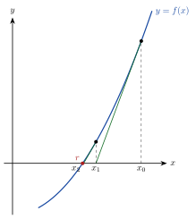

<!-- video: kommer (videoer/kalkulus/04-06-newtons-metode) -->
{fig-alt="Video kommer"}

<!-- tillegg: Claude -->
Likningen $\cos x = x$ har en løsning, men ingen formel gir den. Det samme gjelder de fleste likninger fra virkeligheten. [Halveringsmetoden](../02-grenseverdier/03-kontinuitet.qmd) virker alltid, men er langsom. Newtons metode bruker den deriverte og er vanligvis mye raskere: Antall riktige siffer dobles omtrent for hvert steg.

## Idéen

Vi vil løse $f(x) = 0$ og har et startgjett $x_0$. Erstatt grafen med tangenten i $x_0$, og finn hvor **tangenten** krysser $x$-aksen. Det punktet, $x_1$, er som regel nærmere nullpunktet. Gjenta.

{.tikz-fig fig-alt="En voksende kurve som krysser x-aksen i r. Fra punktet over x0 er tangenten trukket ned til x-aksen i x1, og fra punktet over x1 er en ny tangent trukket ned til x2, som ligger svært nær r."}

Tangenten i $x_n$ er $y = f(x_n) + f'(x_n)(x - x_n)$. Den er null når $x = x_n - \dfrac{f(x_n)}{f'(x_n)}$.

::: {.callout-important title="Newtons metode"}
$$
x_{n + 1} = x_n - \frac{f(x_n)}{f'(x_n)}
$$
:::

::: {.eksempel}
**Eksempel: Kvadratroten av 2.** Bruk Newtons metode på $f(x) = x^2 - 2$ med $x_0 = 1$.

::: {.losning}
$f'(x) = 2x$, så
$$
x_{n + 1} = x_n - \frac{x_n^2 - 2}{2x_n} = \frac12\left(x_n + \frac{2}{x_n}\right) .
$$
$$
x_1 = 1.5, \quad x_2 = 1.416\,667, \quad x_3 = 1.414\,215\,7, \quad x_4 = 1.414\,213\,562\,37 .
$$
Med $\sqrt2 = 1.414\,213\,562\,37\ldots$ har $x_2$ tre riktige siffer, $x_3$ seks og $x_4$ tolv. Dette er babylonernes metode for kvadratrøtter, nesten 4000 år gammel.
:::
:::

::: {.eksempel}
**Eksempel: cos x = x.** Løs $\cos x = x$ med $x_0 = 1$.

::: {.losning}
$f(x) = \cos x - x$, $f'(x) = -\sin x - 1$:
$$
x_{n + 1} = x_n + \frac{\cos x_n - x_n}{\sin x_n + 1} .
$$
$$
x_1 = 0.750\,364, \quad x_2 = 0.739\,113, \quad x_3 = 0.739\,085\,133, \quad x_4 = 0.739\,085\,133\,2 .
$$
Fire steg gir ti riktige desimaler. Halveringsmetoden trenger over 30 halveringer for det samme.
:::
:::

## Hvor fort, og når går det galt?

Nær et enkelt nullpunkt $r$ (der $f'(r) \neq 0$) er feilen etter ett steg omtrent proporsjonal med kvadratet av feilen før:
$$
|x_{n + 1} - r| \approx C\,|x_n - r|^2, \qquad C = \left|\frac{f''(r)}{2f'(r)}\right| .
$$
Det kalles **kvadratisk konvergens**: Er feilen $10^{-3}$, blir den neste omtrent $10^{-6}$. Men metoden er ikke idiotsikker:

::: {.kort}
- **Vannrett tangent** Er $f'(x_n) \approx 0$, sender tangenten neste gjett langt av gårde.
- **Dårlig startgjett** Metoden kan finne et annet nullpunkt enn det vi ville, eller hoppe fram og tilbake uten å komme noen vei.
- **Dobbelt nullpunkt** Er $f'(r) = 0$ (f.eks. $x^2 = 0$), konvergerer metoden bare lineært.
:::

Et plott av funksjonen før du starter er den beste forsikringen. Halveringsmetoden er tregere, men alltid sikker når fortegnet skifter. I praksis kombinerer gode programmer de to.

::: {.eksempel}
**Eksempel: En metode som svikter.** Vis hva som skjer med $f(x) = x^3 - 2x + 2$ og $x_0 = 0$.

::: {.losning}
$f'(x) = 3x^2 - 2$. Med $x_0 = 0$: $x_1 = 0 - \dfrac{2}{-2} = 1$. Med $x_1 = 1$: $x_2 = 1 - \dfrac{1}{1} = 0$. Metoden hopper mellom $0$ og $1$ for alltid. Det eneste reelle nullpunktet er ca. $-1.7693$, og med $x_0 = -2$ finner metoden det på fire steg.
:::
:::

## Prøv selv

```{.python .kjor}
import numpy as np

def newton(f, df, x, n=8):
    for i in range(n):
        x = x - f(x) / df(x)
        print(f"x{i+1} = {x:.15f}")
    return x

f  = lambda x: np.cos(x) - x
df = lambda x: -np.sin(x) - 1
newton(f, df, 1.0)
# Prøv f(x) = x**3 - 2*x + 2 med startverdi 0 og med -2.
```

:::: {.oppgaver}

::: {.oppgave tittel="Tredjerot"}
Bruk Newtons metode med $x_0 = 2$ til å finne $\sqrt[3]{10}$ med fem desimaler.

::: {.losning}
$f(x) = x^3 - 10$, $x_{n + 1} = x_n - \dfrac{x_n^3 - 10}{3x_n^2}$.

$x_1 = 2 + \dfrac{2}{12} = 2.166\,667$, $x_2 = 2.154\,503$, $x_3 = 2.154\,434\,7$. Svar: $\underline{\underline{2.15443}}$.
:::
:::

::: {.oppgave tittel="Skjæringspunkt"}
Finn skjæringspunktet mellom $y = \mathrm{e}^{-x}$ og $y = x$ med fire desimaler.

::: {.losning}
$f(x) = \mathrm{e}^{-x} - x$, $f'(x) = -\mathrm{e}^{-x} - 1$. Med $x_0 = 0.5$: $x_1 = 0.566\,311$, $x_2 = 0.567\,143$, $x_3 = 0.567\,143\,3$. Svar: $\underline{\underline{x = 0.5671}}$ (og $y$ er det samme).
:::
:::

::: {.oppgave tittel="Dybden til en kule" niva="Middels"}
En trekule med radius $R = 10\ \mathrm{cm}$ og tetthet $0.60$ ganger vannets flyter i vann. Dybden $h$ den synker ned, oppfyller $\pi h^2\left(R - \dfrac{h}{3}\right) = 0.60\cdot\dfrac43\pi R^3$, altså $h^3 - 30h^2 + 2400 = 0$ (med $h$ i cm). Finn $h$.

::: {.losning}
$f(h) = h^3 - 30h^2 + 2400$, $f'(h) = 3h^2 - 60h$. Løsningen må ligge mellom $10$ og $20$ (kula er mer enn halvveis nede siden tettheten er over $0.5$). Med $h_0 = 12$: $f(12) = 1728 - 4320 + 2400 = -192$, $f'(12) = 432 - 720 = -288$, så $h_1 = 12 - \dfrac{-192}{-288} = 11.333$. Videre $h_2 = 11.341$, $h_3 = 11.341$. Svar: $\underline{\underline{h = 11.3\ \mathrm{cm}}}$.
:::
:::

::: {.oppgave tittel="Kvadratisk konvergens" niva="Utfordrende"}
For $f(x) = x^2 - 2$: Vis at $x_{n + 1} - \sqrt2 = \dfrac{(x_n - \sqrt2)^2}{2x_n}$. Hva sier det om hvor fort feilen avtar?

::: {.losning}
$$
x_{n + 1} - \sqrt2 = \frac{x_n^2 + 2}{2x_n} - \sqrt2 = \frac{x_n^2 - 2\sqrt2\,x_n + 2}{2x_n} = \frac{(x_n - \sqrt2)^2}{2x_n} .
$$
Den nye feilen er proporsjonal med kvadratet av den gamle, med faktor $\dfrac{1}{2x_n} \approx \dfrac{1}{2\sqrt2} \approx 0.35$. Antall riktige siffer dobles omtrent for hvert steg. Det stemmer med $C = \left|\dfrac{f''}{2f'}\right| = \dfrac{2}{4\sqrt2}$.
:::
:::

::::
